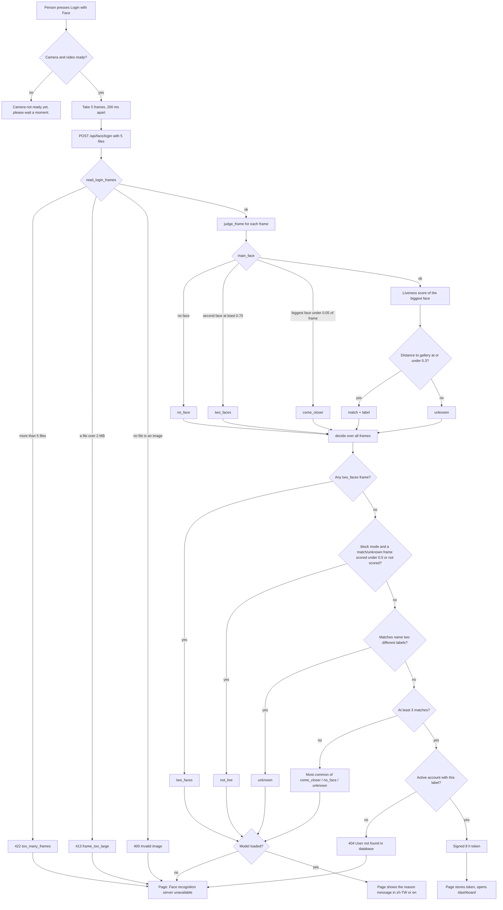

# Face login that picks the right person

Built on 8 Nov 2026, branch `version-4-competition`, commits `7bec6ae`, `d39384c`, `c9b2448`, `b34526a`, `5cb05f9`, `cd0a166`, `b191523`, `2cc2a52` and `ae431cb` (`7bec6ae..ae431cb`). Line numbers below are at HEAD `e96ecf6`.

## What it does

Face login no longer trusts one photo. One press of the button takes 5 photos (frames) 200 ms apart and sends them in one request. In each frame the server looks only at the biggest face: if a second face is almost as big, or the biggest face is too small, that frame is refused with a reason. A small model (MiniFASNetV2, a "liveness" model: it guesses whether the face is a real person or a photo on a phone or paper) scores the biggest face. The person is logged in only when at least 3 of the 5 frames match the same registered person; any frame with two faces, two different people among the matches, or (in `block` mode) a low liveness score refuses the login. The page then shows a short reason in Chinese or English, such as "Please come closer to the camera."

## The flow

Words used below: a **frame** is one camera photo. A **label** is the name the face gallery uses for an account (`"user".face_label`). A **reason code** is the one-word result the server sends back: `match`, `unknown`, `no_face`, `come_closer`, `two_faces` or `not_live`.

1. **The person opens the login page and chooses "Face".** The page starts the camera. The button stays disabled until the camera and video are ready.
   - Camera refused or missing: the page shows `Camera access denied or not available`.
2. **The person presses "Login with Face".** The button turns into `Scanning…` / `掃描中…` and is disabled.
   - Video not ready yet: `Camera not ready yet, please wait a moment.`
   - Pressing again within 300 ms does nothing.
3. **The page takes 5 frames, 200 ms apart (about 1 second),** as JPEG files `face0.jpg` to `face4.jpg`.
   - No canvas in the browser: the error text `Canvas not available`.
4. **The page sends the 5 files in one request** (multipart form, field `files`) to `POST /api/face/login`.
   - Network failure: the page shows the browser's error text (for example `Failed to fetch`).
5. **The server reads the files** (`read_login_frames`). Each file that is not an image becomes an empty frame, judged later as `no_face`.
   - More than `FACE_LOGIN_FRAMES` (5) files: 422 `too_many_frames`.
   - One file over 2 MB: 413 `frame_too_large`.
   - No file is an image: 400 `Invalid image`.
   - The React page shows all three as `Face recognition server unavailable. Please try again later.` (it only sees "HTTP 4xx").
6. **The server judges each frame** (`judge_frame`):
   1. The detector finds every face in the frame.
   2. `main_face` ranks them by area. No face: `no_face`. A second face with at least 70% of the biggest face's area: `two_faces`. The biggest face under 5% of the frame: `come_closer`. Otherwise `ok`.
   3. If there is a biggest face, the liveness model scores it (0 to 1, 1 = real). No score (model missing, bad frame) is `None`.
   4. Only an `ok` frame is matched against the gallery. Distance at or under `FACE_MATCH_THRESHOLD` (0.3): `match` with that label. Otherwise `unknown`.
   - The face model is not loaded: every frame is `no_face`.
   - Any error inside one frame: that frame is `no_face` (one ERROR log line).
7. **The server decides over all frames** (`decide`), in this order:
   1. Any frame is `two_faces`: the login fails with `two_faces`.
   2. In `block` mode only: any `match` or `unknown` frame with a liveness score under the threshold (0.5), or with no score, fails the login with `not_live`. In `log` mode (the default) the scores are only written to the log.
   3. The `match` frames name two different labels: the login fails with `unknown`.
   4. At least `FACE_LOGIN_MIN_MATCHES` (3) frames match: the login succeeds as `match`.
   5. Otherwise the most common other code wins (`unknown`, `no_face` or `come_closer`). A tie goes to `come_closer`, then `no_face`, then `unknown`.
8. **The server writes one log line** with the reason, the frame count, the number of matches and the 5 liveness scores (no names).
9. **Not identified:** the route logs `account=-` and answers 200 with `identified: false` and the `reason`. The page shows the reason's message:

   | Reason | English | 繁體中文 |
   | --- | --- | --- |
   | `come_closer`, `no_face` | Please come closer to the camera. | 請靠近鏡頭一點。 |
   | `two_faces` | Two people are close to the camera. Please let one person come closer. | 有兩個人靠近鏡頭，請讓一個人靠近一點。 |
   | `not_live` | Please look at the camera yourself. | 請本人看著鏡頭。 |
   | `unknown` (and any other code) | Face not recognised. Try email login below. | 無法辨識臉部，請改用下方的電子郵件登入。 |

   - Face model not loaded: the answer carries `error: "Model not loaded"`, and the page shows `Face recognition server unavailable. Please try again later.` instead of "come closer".
10. **Identified:** the server looks up the active account with that label.
    - No active account has it: 404 `User not found in database`. The React page shows `Face recognition server unavailable. Please try again later.` (it only sees "HTTP 404"; this message is misleading for that case).
11. **Account found:** the server signs a session token (`u_id` and name, valid 8 hours), logs `account=<u_id>`, and answers with `token` and `u_id`.
12. **The page stores the token** (`face_auth_token` in the browser) and goes to `/dashboard`.
    - Identified but no token in the answer: `Login error: session token missing. Please try again.`

**The other routes use the same steps 5 to 8:**

- `POST /api/face/identify`: answers the decision only (no account lookup, no token).
- `POST /api/auth/face-login`: not identified is 401 with `Face not recognized` (or `Model not loaded`); identified without an active account is 404 `Face recognized but no account found`; success returns `token` and `user`, and also sets the `medai_session` cookie.
- The older HTML page (`/auth/login`, `static/js/face_login.js`) sends 5 frames to `POST /auth/face-frame`, again and again with a 500 ms pause, until someone is recognised. It shows the same English reason texts. `Server unavailable. Trying again…` for an HTTP error or `Model not loaded`. When identified the answer also has a signed `login_ticket` (valid 60 seconds), and the page shows `Welcome back, <name>! Click Confirm Login to continue.` The Confirm button posts only the ticket to `POST /auth/confirm-login`:
  - Missing, bad or expired ticket: 400 `invalid_ticket` (the person sees raw JSON).
  - No active account with that label: redirect to `/auth/register`.
  - Account found: a session cookie and a redirect to `/display/`.
  - The ticket is not single-use: it works again within its 60 seconds.

## Diagram



## The code that runs it

### Step 1-3: the page takes 5 frames

`frontend_source/src/pages/Login.tsx:9-17`

```tsx
const FRAME_COUNT = 5;
const FRAME_GAP_MS = 200;
const REASON_KEYS: Record<string, string> = {
  come_closer: 'login.face.comeCloser',
  no_face: 'login.face.comeCloser',
  two_faces: 'login.face.twoFaces',
  not_live: 'login.face.notLive',
  unknown: 'login.face.unknown',
};
```

The page always takes 5 frames 200 ms apart. `REASON_KEYS` turns each reason code into a message key in `i18n.ts`. `no_face` uses the same message as `come_closer`.

`frontend_source/src/pages/Login.tsx:90-100`

```tsx
  const handleFaceLogin = async () => {
    if (!videoRef.current || !cameraOn || !videoReady) return;
    if (debounceRef.current) return;
    debounceRef.current = true;
    setTimeout(() => { debounceRef.current = false; }, 300);

    const video = videoRef.current;
    if (!video.videoWidth || !video.videoHeight || video.readyState < 2) {
      setError('Camera not ready yet, please wait a moment.');
      return;
    }
```

The press is ignored while the camera is off, the video is not ready, or within 300 ms of the last press. A video without a size shows "Camera not ready yet".

`frontend_source/src/pages/Login.tsx:105-121`

```tsx
    try {
      const canvas = document.createElement('canvas');
      canvas.width = video.videoWidth;
      canvas.height = video.videoHeight;
      const ctx = canvas.getContext('2d');
      if (!ctx) throw new Error('Canvas not available');

      // 5 frames, 200 ms apart (about 1 s), then one request.
      const frames: File[] = [];
      for (let i = 0; i < FRAME_COUNT; i++) {
        if (i > 0) await new Promise((r) => setTimeout(r, FRAME_GAP_MS));
        ctx.drawImage(video, 0, 0);
        const blob = await new Promise<Blob>((resolve) =>
          canvas.toBlob((b) => resolve(b!), 'image/jpeg', 0.9)
        );
        frames.push(new File([blob], `face${i}.jpg`, { type: 'image/jpeg' }));
      }
```

It draws the live video onto a canvas 5 times and saves each picture as a JPEG file at quality 0.9.

### Step 4: one request with all 5 files

`frontend_source/src/lib/ai-api.ts:43-52`

```ts
  async faceLogin(frames: File[]): Promise<FaceAnswer & { token?: string; u_id?: number }> {
    const form = new FormData();
    frames.forEach((f) => form.append('files', f));
    const resp = await fetch('/api/face/login', { method: 'POST', body: form });
    if (!resp.ok) {
      const err = await resp.json().catch(() => ({}));
      return { identified: false, error: err.detail || `HTTP ${resp.status}` };
    }
    return resp.json();
  },
```

All frames go in one form under the field name `files`. Any non-200 answer becomes the error `HTTP <status>`: the server's own error text is in `error`, not `detail`, so it is lost here.

### Step 5: the server reads the files

`app/routers/api_face.py:43-63`

```python
async def read_login_frames(files: List[UploadFile]) -> list[np.ndarray | None]:
    """Decode 1 to FACE_LOGIN_FRAMES uploads. An upload that is not an image becomes None, which login judges
    as a frame without a face. Raises FrameUploadError: 422 too_many_frames, 413 for a file over 2 MB,
    400 Invalid image when no upload is an image."""
    if len(files) > FACE_LOGIN_FRAMES:
        raise FrameUploadError(422, "too_many_frames")
    frames: list[np.ndarray | None] = []
    for upload in files:
        data = await upload.read(MAX_FRAME_BYTES + 1)
        if len(data) > MAX_FRAME_BYTES:
            raise FrameUploadError(413, "frame_too_large")
        frame = None
        if data:
            try:
                frame = cv2.imdecode(np.frombuffer(data, np.uint8), cv2.IMREAD_COLOR)
            except cv2.error:
                frame = None
        frames.append(frame)
    if all(frame is None for frame in frames):
        raise FrameUploadError(400, "Invalid image")
    return frames
```

It reads at most 2 MB + 1 byte of each file, so a large file is refused without reading all of it. A broken file becomes `None` (a frame without a face) instead of failing the whole login.

### Step 6: one verdict per frame

`app/services/face_recognition_service.py:228-248`

```python
    def judge_frame(self, frame_bgr: np.ndarray | None) -> FrameVerdict:
        """One verdict for one frame: the biggest face is scored for liveness and matched; no other face is.
        None (an upload that was not an image) is a frame without a face."""
        if frame_bgr is None or not FaceRecognitionService._available:
            return FrameVerdict("no_face")
        try:
            boxes = self.detect(frame_bgr)
            frame_h, frame_w = frame_bgr.shape[:2]
            code, main = main_face(boxes, frame_w, frame_h, min_area_ratio=FACE_MIN_AREA_RATIO,
                                   second_ratio=FACE_SECOND_FACE_RATIO)
            if main is None:
                return FrameVerdict(code, face_count=len(boxes))
            liveness = LivenessService.get_instance().score(frame_bgr, main)
            if code != "ok":
                return FrameVerdict(code, liveness=liveness, face_count=len(boxes))
            label, distance = self.match_box(frame_bgr, main)
            return FrameVerdict("match" if label is not None else "unknown", label, distance,
                                liveness, len(boxes))
        except Exception as exc:
            log.error("face login frame failed: %s", type(exc).__name__)
            return FrameVerdict("no_face")
```

Only the biggest face (`main`) is scored and matched. A `two_faces` or `come_closer` frame still gets a liveness score but is never matched.

`app/services/face_login.py:59-69`

```python
def main_face(boxes: list[FaceBox], frame_w: int, frame_h: int, *, min_area_ratio: float,
              second_ratio: float) -> tuple[str, FaceBox | None]:
    if not boxes:
        return "no_face", None
    ranked = sorted(boxes, key=lambda b: b.area, reverse=True)
    main = ranked[0]
    if len(ranked) > 1 and ranked[1].area >= second_ratio * main.area:
        return "two_faces", main
    if main.area < min_area_ratio * frame_w * frame_h:
        return "come_closer", main
    return "ok", main
```

`main_face` sorts the faces by area. It checks for a second big face first, then for a too-small biggest face.

`app/services/liveness_service.py:142-163`

```python
    def score(self, frame_bgr: np.ndarray, box: FaceBox) -> float | None:
        """The probability (0..1) that the face in `box` is real, or None."""
        session = self._get_session()
        if session is None:
            self._warn_problem()
            return None
        if not (isinstance(frame_bgr, np.ndarray) and frame_bgr.ndim == 3 and frame_bgr.shape[2] == 3
                and frame_bgr.shape[0] >= 2 and frame_bgr.shape[1] >= 2):
            self._warn("bad_frame", "the frame is not a BGR image")
            return None
        if not all(math.isfinite(v) for v in (box.x, box.y, box.w, box.h)) or box.w <= 0 or box.h <= 0:
            self._warn("bad_box", "the face box has no area or is not a number")
            return None
        try:
            tensor = preprocess(frame_bgr, box)
            logits = session.run(None, {session.get_inputs()[0].name: tensor})[0][0].astype(np.float64)
            probs = np.exp(logits - logits.max())
            probs /= probs.sum()
            real = float(probs[REAL_INDEX])
            if not math.isfinite(real):
                raise ValueError("the model gave a non-finite score")
            return real
```

The liveness model returns 3 numbers; after softmax, index 1 is the chance that the face is real. Any problem gives `None` and one WARNING per kind of problem.

`app/services/face_recognition_service.py:219-226`

```python
    def _match_descriptor(self, descriptor: np.ndarray, identities) -> tuple[str | None, float]:
        """Login's rule: each label's closest descriptor, then the closest label (MIN_DIST); a distance above
        FACE_MATCH_THRESHOLD is no label."""
        index, distance = identities.match_faces([descriptor], self.face_id.match_algo)[0]
        distance = float(distance)
        if self.face_id.match_threshold < distance:
            return None, distance
        return identities[index].label, distance
```

The face's 256-number descriptor is compared with each registered label (smallest distance, `MIN_DIST`). A distance above `FACE_MATCH_THRESHOLD` means no label.

### Step 7: the decision over all frames

`app/services/face_login.py:72-96`

```python
def decide(verdicts: list[FrameVerdict], *, min_matches: int, liveness_mode: str,
           liveness_threshold: float) -> LoginDecision:
    frames = len(verdicts)
    face_count = max((v.face_count for v in verdicts), default=0)

    def fail(reason: str) -> LoginDecision:
        return LoginDecision(False, None, None, reason, frames, face_count)

    if any(v.code == "two_faces" for v in verdicts):
        return fail("two_faces")

    if blocks_liveness(liveness_mode):
        # Only frames that judged a face (match / unknown) carry a liveness score.
        judged = [v for v in verdicts if v.code in ("match", "unknown")]
        if any(v.liveness is None or v.liveness < liveness_threshold for v in judged):
            return fail("not_live")

    matches = [v for v in verdicts if v.code == "match"]
    if len({v.label for v in matches}) > 1:
        return fail("unknown")

    if len(matches) >= min_matches:
        return LoginDecision(True, matches[0].label,
                             min(v.distance for v in matches if v.distance is not None),
                             "match", frames, face_count)
```

The order matters: two faces fail first, then liveness (only in `block` mode, only on frames that reached matching), then two different people, then the 3-match rule. The reported distance is the smallest one among the matching frames.

`app/services/face_login.py:98-104`

```python
    counts = Counter(v.code for v in verdicts if v.code != "match")
    if not counts:
        return fail("unknown")
    best = max(counts.values())
    tied = [c for c, n in counts.items() if n == best]
    tied.sort(key=lambda c: _TIE_ORDER.index(c) if c in _TIE_ORDER else len(_TIE_ORDER))
    return fail(tied[0])
```

When the login fails without a special case, the most common non-match code is the reason. `_TIE_ORDER` (line 56) breaks a tie: `come_closer`, then `no_face`, then `unknown`.

### Step 8: the log line

`app/services/face_recognition_service.py:250-258`

```python
    def login(self, frames: list[np.ndarray | None]) -> LoginDecision:
        """Judge each frame, then decide the login from all of them. Logs one line (no names)."""
        verdicts = [self.judge_frame(f) for f in frames]
        decision = decide(verdicts, min_matches=FACE_LOGIN_MIN_MATCHES, liveness_mode=FACE_LIVENESS_MODE,
                          liveness_threshold=FACE_LIVENESS_THRESHOLD)
        scores = [None if v.liveness is None else round(v.liveness, 2) for v in verdicts]
        log.info("face login: reason=%s frames=%d matches=%d liveness=%s mode=%s", decision.reason,
                 len(verdicts), sum(v.code == "match" for v in verdicts), scores, FACE_LIVENESS_MODE)
        return decision
```

`login` judges every frame, calls `decide` with the settings, and writes one INFO line with the liveness scores rounded to 2 places.

### Step 9-11: the route answers

`app/routers/api_face.py:71-86`

```python
def login_answer(decision: LoginDecision) -> dict:
    """The face answer's keys: today's (identified, name, distance, face_count, error) plus reason and frames."""
    return {
        "identified": decision.identified,
        "name": decision.label,
        "distance": decision.distance,
        "face_count": decision.face_count,
        "error": None if FaceRecognitionService._available else "Model not loaded",
        "reason": decision.reason,
        "frames": decision.frames,
    }


def log_login(u_id: int | None, reason: str) -> None:
    """The route's one line per login: the account id (or -), never the name."""
    logger.info("face login: account=%s reason=%s", u_id if u_id is not None else "-", reason)
```

Every face route builds its answer with `login_answer`. `error` is `Model not loaded` when the face model did not start. `log_login` writes the account id, never the name.

`app/routers/api_face.py:100-113`

```python
@router.post("/login")
async def face_login(files: List[UploadFile] = File(...)):
    """Decide the face login from up to FACE_LOGIN_FRAMES photos; when identified, return a signed session
    token for API access."""
    try:
        frames = await read_login_frames(files)
    except FrameUploadError as exc:
        return JSONResponse({"identified": False, "error": exc.error}, status_code=exc.status)
    decision = await run_login(frames)
    result = login_answer(decision)

    if not decision.identified:
        log_login(None, decision.reason)
        return result
```

Not identified: the route logs `account=-` and returns the reason.

`app/routers/api_face.py:115-130`

```python
    face_label = decision.label.lower()
    pool = get_pool()
    async with pool.acquire() as conn:
        row = await conn.fetchrow(
            'SELECT u_id, name FROM "user" WHERE face_label = $1 AND user_active = TRUE',
            face_label,
        )

    if not row:
        log_login(None, decision.reason)
        return JSONResponse({"identified": False, "error": "User not found in database",
                             "reason": decision.reason, "frames": decision.frames}, status_code=404)

    log_login(row["u_id"], decision.reason)
    token = _face_signer.dumps({"u_id": row["u_id"], "name": row["name"]})
    return {**result, "token": token, "u_id": row["u_id"]}
```

Identified: it looks up the active account with that label. No account is a 404; otherwise it signs a token with `SECRET_KEY` and returns it with the `u_id`.

### Step 12: the page shows the result

`frontend_source/src/pages/Login.tsx:131-140`

```tsx
      if (result.error && (result.error.includes('HTTP') || result.error === 'Model not loaded')) {
        setError('Face recognition server unavailable. Please try again later.');
      } else if (result.identified && result.name && result.token) {
        setFaceSession({ name: result.name, loginAt: new Date().toISOString(), u_id: result.u_id }, result.token);
        window.location.href = '/dashboard';
      } else if (result.identified && result.name) {
        setError('Login error: session token missing. Please try again.');
      } else {
        setError(t(REASON_KEYS[result.reason ?? 'unknown'] ?? 'login.face.unknown'));
      }
```

Any `HTTP` error or `Model not loaded` shows the "server unavailable" message. A match with a token stores the session and opens the dashboard. Everything else shows the reason's message.

`frontend_source/src/i18n.ts:12-18`

```ts
        face: {
          scanning: 'Scanning…',
          comeCloser: 'Please come closer to the camera.',
          twoFaces: 'Two people are close to the camera. Please let one person come closer.',
          notLive: 'Please look at the camera yourself.',
          unknown: 'Face not recognised. Try email login below.',
        },
```

The English messages (`login.face.*`).

`frontend_source/src/i18n.ts:797-803`

```ts
        face: {
          scanning: '掃描中…',
          comeCloser: '請靠近鏡頭一點。',
          twoFaces: '有兩個人靠近鏡頭，請讓一個人靠近一點。',
          notLive: '請本人看著鏡頭。',
          unknown: '無法辨識臉部，請改用下方的電子郵件登入。',
        },
```

The Traditional Chinese messages (same keys).

### The other routes

`app/routers/api_auth.py:52-63`

```python
    try:
        frames = await read_login_frames(files)
    except FrameUploadError as exc:
        return JSONResponse({"success": False, "error": exc.error}, status_code=exc.status)

    decision = await run_login(frames)
    face = {"reason": decision.reason, "frames": decision.frames}

    if not decision.identified:
        log_login(None, decision.reason)
        error = "Face not recognized" if FaceRecognitionService._available else "Model not loaded"
        return JSONResponse({"success": False, "error": error, **face}, status_code=401)
```

`/api/auth/face-login` uses the same reading and deciding, but answers 401 when nobody is identified.

`app/routers/auth.py:53-65`

```python
@router.post("/face-frame")
async def face_frame(files: List[UploadFile] = File(...)):
    """Up to FACE_LOGIN_FRAMES photos, return the face login decision; when identified, also a login_ticket
    (valid TICKET_MAX_AGE seconds) for /auth/confirm-login."""
    try:
        frames = await read_login_frames(files)
    except FrameUploadError as exc:
        return JSONResponse({"identified": False, "error": exc.error}, status_code=exc.status)
    decision = await run_login(frames)
    result = login_answer(decision)
    if decision.identified:
        result["login_ticket"] = _ticket_signer.dumps(decision.label)
    return JSONResponse(result)
```

`/auth/face-frame` (the older page) adds a `login_ticket` when someone is identified. The ticket holds only the label and is signed with the salt `face-login-ticket`.

`app/routers/auth.py:68-76`

```python
@router.post("/confirm-login")
async def confirm_login(response: Response, ticket: str = Form("")):
    """Turn a login_ticket from /auth/face-frame into a session cookie. A missing, bad or expired ticket is 400."""
    try:
        name = _ticket_signer.loads(ticket, max_age=TICKET_MAX_AGE) if ticket else None
    except BadSignature:
        name = None
    if not isinstance(name, str) or not name:
        return JSONResponse({"error": "invalid_ticket"}, status_code=400)
```

`/auth/confirm-login` accepts only a ticket younger than `TICKET_MAX_AGE` (60 s). Anything else is 400 `invalid_ticket`.

`static/js/face_login.js:46-65`

```javascript
  try {
    const resp = await fetch('/auth/face-frame', { method: 'POST', body: form });
    const data = await resp.json();

    if (data.identified && data.login_ticket) {
      stopCamera(_stream);
      status.textContent = 'Recognised';
      status.className = 'text-success small mb-3';
      document.getElementById('loginTicket').value = data.login_ticket;
      document.getElementById('recognisedMsg').textContent =
        `Welcome back, ${data.name}! Click Confirm Login to continue.`;
      document.getElementById('confirmForm').classList.remove('d-none');
      return true;
    } else if (!resp.ok || data.error === 'Model not loaded') {
      status.textContent = 'Server unavailable. Trying again…';
    } else if (data.error) {
      status.textContent = 'Model: ' + data.error;
    } else {
      status.textContent = REASON_TEXT[data.reason] || 'Scanning…';
    }
```

The older page tries again after every failed attempt and shows the English reason text from `REASON_TEXT` (lines 6-12).

## Settings

| Setting | Default | Read at | What it changes |
| --- | --- | --- | --- |
| `FACE_LOGIN_FRAMES` (env) | `5` (at least 1) | `app/config.py:66`; used `app/routers/api_face.py:47` | The most files one login may send. The pages always send 5 (`Login.tsx:9`, `face_login.js:3`), so a value under 5 makes every page login a 422. |
| `FACE_LOGIN_MIN_MATCHES` (env) | `3` (clamped to 1..`FACE_LOGIN_FRAMES`) | `app/config.py:68`; used `app/services/face_recognition_service.py:253` | How many frames must match the same person. |
| `FACE_MIN_AREA_RATIO` (env) | `0.05` | `app/config.py:64`; used `face_recognition_service.py:236` | Biggest face smaller than this share of the frame is `come_closer`. |
| `FACE_SECOND_FACE_RATIO` (env) | `0.70` | `app/config.py:65`; used `face_recognition_service.py:237` | A second face at least this share of the biggest face's area is `two_faces`. |
| `FACE_LIVENESS_MODE` (env) | `log` (trimmed, lower-cased; any value but `block` means `log`) | `app/config.py:70`; used `face_recognition_service.py:253`, `app/startup_report.py:101` | `log`: scores only logged. `block`: a low or missing score is `not_live`. The running container's startup line on 9 Nov says `mode block`. |
| `FACE_LIVENESS_THRESHOLD` (env) | `0.5` | `app/config.py:79`; used `face_recognition_service.py:254` | Score under this is "not live" in `block` mode. Not yet measured on this webcam (`HANDOFF.md` section 15). |
| `FACE_LIVENESS_MODEL` (env) | `models/liveness/MiniFASNetV2.onnx` | `app/config.py:75-78`; used `app/services/liveness_service.py:81` | The liveness model file. It must match `MODEL_SHA256` (`liveness_service.py:31`) or every score is `None`. |
| `FACE_MATCH_THRESHOLD` (env) | `0.3` | `app/config.py:61`; used `face_recognition_service.py:68`, check at `:224` | Largest distance that still counts as the same person. Not changed by this feature. |
| `FACE_DET_CONFIDENCE` (env) | `0.6` | `app/config.py:60`; used `face_recognition_service.py:59` | How sure the detector must be to report a face. Not changed by this feature. |
| `MAX_FRAME_BYTES` (constant) | 2 MB | `app/routers/api_face.py:31` | Largest file per frame (413 above it). |
| `TICKET_MAX_AGE` (constant) | 60 s | `app/routers/auth.py:18` | How long the older page's `login_ticket` works. |
| `_FACE_SESSION_MAX_AGE` (constant) | 8 hours | `app/dependencies.py:10` | How long the login token is accepted. |
| `CROP_SCALE`, `INPUT_SIZE` (constants) | 2.7, 80 | `app/services/liveness_service.py:32-33` | The liveness crop: the face box widened 2.7 times, resized to 80x80. |
| `FRAME_COUNT`, `FRAME_GAP_MS` (constants) | 5, 200 ms | `frontend_source/src/pages/Login.tsx:9-10`; `static/js/face_login.js:3-4` | Frames per press and the gap between them. |
| `PAUSE_MS` (constant) | 500 ms | `static/js/face_login.js:5` | The older page's pause between attempts. |
| `_TIE_ORDER` (constant) | `come_closer`, `no_face`, `unknown` | `app/services/face_login.py:56` | Which reason wins a tie. |

An env change needs the container recreated: `docker compose up -d app`. A changed liveness model file needs an image rebuild (`.\scripts\rebuild-app.ps1`, only while no dose session runs).

## Logs to read

The lines the feature writes (logger name after `INFO:` / `WARNING:` / `ERROR:`):

| Line | Written by | When |
| --- | --- | --- |
| `INFO:app.services.face_recognition_service:face login: reason=<code> frames=<n> matches=<n> liveness=[<5 scores or None>] mode=<log or block>` | `face_recognition_service.py:256-257` | Every login, once. |
| `INFO:app.routers.api_face:face login: account=<u_id or -> reason=<code>` | `api_face.py:86` | Every login on `/api/face/login`, `/api/auth/face-login` and `/auth/confirm-login` (not `/api/face/identify` or `/auth/face-frame`). |
| `ERROR:app.services.face_recognition_service:face login frame failed: <error class>` | `face_recognition_service.py:247` | One frame crashed; it counts as `no_face`. |
| `WARNING:app.services.liveness_service:liveness <kind>: <detail> (further ones are not logged)` | `liveness_service.py:110` | First time per kind: `model_missing`, `model_integrity`, `model_load`, `bad_frame`, `bad_box`, `inference_failed`. |
| `INFO:app.startup:[STARTUP] liveness: OK MiniFASNetV2.onnx loaded, mode <mode> (<use>), threshold <t>` | `app/startup_report.py:64`, text from `:98-108` | At startup. When the model is missing or the mode is a typo it is `WARNING:app.startup:[STARTUP] liveness: DEGRADED: ...` instead (`startup_report.py:66`; `app/main.py:107` marks the stage with `warn=True`), not `FAILED`. |

Commands (PowerShell):

```powershell
# Every face login, newest last
docker logs medcareai2-app-1 2>&1 | Select-String "face login"

# Only the decisions with the liveness scores
docker logs medcareai2-app-1 2>&1 | Select-String "face login: reason="

# Liveness model state at startup and any liveness warnings
docker logs medcareai2-app-1 2>&1 | Select-String "liveness"

# Is the liveness model loaded? ("liveness": true)
Invoke-RestMethod http://localhost:8080/health | Select-Object liveness
```

No image, face vector, token or name is ever logged.

## How to test it

**Automatic tests** (backend: `python -m pytest tests -q -p no:cacheprovider` in the project's Python environment):

- `tests/test_face_login_rules.py`: the pure rules. For example `test_largest_face_wins`, `test_two_faces_at_070_not_at_069`, `test_small_face_is_come_closer`, `test_three_of_five_logs_in`, `test_two_of_five_does_not`, `test_one_two_faces_frame_fails`, `test_not_live_blocks_only_in_block_mode`, `test_another_registered_person_fails_the_login`, `test_reason_ties`, `test_liveness_mode_is_normalised_and_a_typo_is_log`, `test_frame_settings_are_clamped`.
- `tests/test_face_login_service.py`: `judge_frame` and `login` with fake models. For example `test_only_the_main_face_is_matched`, `test_come_closer_and_two_faces_are_not_matched`, `test_liveness_error_by_mode`, `test_login_logs_one_line_without_names`, `test_model_unavailable_gives_no_face_and_error`, `test_a_frame_that_is_not_an_image_is_no_face`, `test_match_box_threshold_boundary`.
- `tests/test_face_login_routes.py`: the 4 routes. For example `test_login_with_five_frames_issues_a_token`, `test_reason_is_returned_when_not_identified`, `test_six_frames_is_422`, `test_frame_over_two_megabytes_is_413`, `test_one_bad_frame_does_not_spoil_the_login`, `test_every_face_route_uses_login`, `test_login_log_has_the_account_not_the_name`, `test_confirm_login_needs_a_ticket`.
- `tests/test_liveness.py`: the model file and its crop. For example `test_missing_model_is_unavailable_and_scores_none`, `test_sha256_matches_source_md`, `test_crop_box_matches_the_original_get_new_box`, `test_health_reports_liveness`.
- `tests/test_startup_report.py`: `test_liveness_stage_fails_on_an_unknown_mode_and_says_log`.
- `frontend_source/tests/face-login.spec.ts` (Playwright, mocked server): `one press sends exactly 5 files, and the button is disabled and says Scanning meanwhile`, `reason <code> shows its copy in English and in Chinese` (one per reason), `match with a token goes to the dashboard`, `a server error keeps the unavailable message`, `model not loaded shows the unavailable message, not "come closer"`. Note: `frontend_source/playwright.config.ts` points `testDir` at a folder that does not exist (`HANDOFF.md` section 14), so run it with a config whose `testDir` is `./tests`.

**Manual check** (app at http://localhost:8080):

1. Open the login page, press **Face**, and wait until the button is enabled.
2. Alone, face filling a good part of the picture: press **Login with Face**. You should reach the dashboard. The log shows `reason=match frames=5 matches=5` (or at least 3).
3. Step back to the far side of the room and press again: `Please come closer to the camera.` / `請靠近鏡頭一點。` (`reason=come_closer`).
4. Two people side by side, about the same distance: `Two people are close to the camera...` (`reason=two_faces`). A second person far behind you (much smaller face) should not stop the login.
5. A person who is not registered: `Face not recognised. Try email login below.` (`reason=unknown`).
6. Switch the language with the language switcher and repeat one case to see the Chinese text.
7. Liveness: show a photo of a registered face on a phone or paper. In `log` mode it may log in; read the scores in the `liveness=[...]` part of the log line. In `block` mode a low score shows `Please look at the camera yourself.` / `請本人看著鏡頭。`. Known limit (8 Nov, `HANDOFF.md` section 15): a bright phone screen held close can still pass.

## Note: registration now stores face vectors

Since 8 Nov 2026 registration uses the same biggest-face rule (`main_face`) and stores each registered face as numbers (a face vector), not as a photo. Face login matches against those stored vectors. See [face-vectors.md](face-vectors.md).
