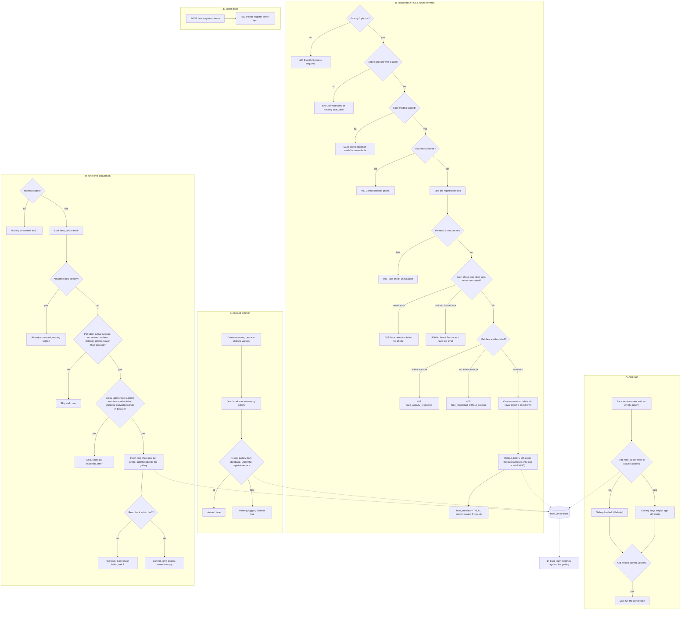

# Face vectors instead of face photos

Built 8 Nov 2026 (the last commit landed just after midnight, 9 Nov), branch `version-4-competition`. Commits, oldest first: `2e74d47` (the table and a gallery built from it), `133f73e` (each label from the owning account), `4f44c79` (three vectors in the database, no photos), `67a052e` (the duplicate check reads the stored vectors first), `e39d858` (deletion by cascade, export summary), `fcd07a2` (one-time conversion, docs), `9ab2260` and `7f16f2b` (conversion skip rules), `e96ecf6` (HANDOFF measurement), `6cffa83` (the conversion refuses a face already under another account, safer reloads, deploy notes).

## What it does

Face login used to keep 3 photos of each person in a folder and compute their face numbers every time the app started. Now the app keeps only the numbers. A "face vector" is a list of 256 numbers that the face model (face-reidentification-retail-0095) computes for one face; two photos of the same person give vectors that are close together. Registration stores 3 vectors per account in the database table `face_vector` and keeps no photo. Face login builds its list of known faces (the "gallery") from that table at start, after every registration and after every account deletion. A one-time script converts the old photos of existing accounts into vectors, so they can still log in by face.

## The flow

**A. The app starts**

1. The face service loads its models with an **empty** gallery.
2. The app start-up code reads every vector of an active account from `face_vector` and gives the gallery to the face service. The log says how many labels (people) it loaded. A "label" is the short name face login uses for one account (`"user".face_label`).
   - If the database read fails, the gallery stays empty, the app still starts, and the log says `the face vectors were not loaded (...): the gallery is empty`. Nobody can log in by face until the next successful load.
3. The app counts photos in the old photo folder whose label has no vectors yet. If there are any, the log warns that face login, the robot and the intake monitor do not recognise them (not converted yet, or skipped by the conversion); run the conversion (part H) if it has not run.

**B. A person registers their face (app onboarding, `POST /api/face/enroll`)**

1. The app sends 3 photos. Not exactly 3: **400** `Exactly 3 photos required`.
2. The server finds the signed-in, active account and its label in the database (never from the request). Not found or no label: **404** `User not found or missing face_label. Complete registration first.`
3. Face models not loaded: **503** `Face recognition model is unavailable`.
4. Each photo is decoded. A photo that is not an image: **400** `Cannot decode photo 0` (the number is the photo's position, starting at 0).
5. The server takes the registration lock (only one registration at a time), then **re-reads all stored vectors** from the database, so the duplicate check sees rows written by any process.
   - If that read fails, nothing is stored: **503** `Face check unavailable. Please try again later.` ("fail closed": when the check cannot run, the answer is no).
6. For each photo, the face service finds the main face (the same rule as face login), computes its vector, and compares it with every **other** account in the gallery (your own old vectors are left out, because they will be replaced).
   - The model failed on the photo: **503** `Face detection failed for photo 0`.
   - No face: **400** `No face detected in photo 0`. Two faces of similar size: **400** `Two faces in photo 0`. Face too small: **400** `Face too small in photo 0`. The app shows this text and lets the person take the photos again.
   - The face is already another active account's: **409** `face_already_registered`. The app shows the panel "This face is already registered to another account" with a "Go to face login" button and "Nothing was saved. The account you are signed in to now still has no face. ..."
   - The face is in the gallery but no active account owns it: **409** `face_registered_without_account`. The app shows "This face is already in the face gallery" and asks the person to have the old face photos removed. The gallery now holds only active accounts' vectors, so in practice this happens only for an account deactivated after the gallery was loaded (the text was not changed).
   - The vector is not 256 numbers: **503** `Face detection failed for photo 0`.
   - One refused photo refuses all three; nothing is stored.
7. In **one database transaction**, the account's old vectors are deleted and the 3 new ones inserted (`source = 'enroll'`). Either all of this happens or none of it.
8. Still holding the registration lock, the gallery is re-read from the database, so the next registration and face login already know this face. The rows are already committed at this point, so if this reload fails, the log gets one WARNING (the error's type only) and the registration still answers success; the next registration's re-read before its check loads the rows.
9. The account is marked `face_enrolled = TRUE`. The answer is `{"saved": ["<id>", "<id>", "<id>"], "face_label": ...}`: three row numbers, never a vector or a file path. The app moves to the next onboarding step.

**C. The app asks "is my face registered?" (`GET /api/face/enrollment-status`)**

1. The answer is `{"enrolled": true/false, "count": N}`, where `count` is the number of `face_vector` rows of the account. The onboarding wizard skips the camera step when `enrolled` is true.

**D. Face login**

1. The matching code did not change. It computes the vector of the biggest face in each login frame and compares it with the gallery (now built from the table). Distance 0.3 or less is a match.

**E. The older registration page (`POST /auth/register-photos`)**

1. This route is retired. It always answers **410** `{"error": "use_app_registration", "detail": "Please register in the app."}` and reads nothing. The old page shows "Please register in the app." in an alert and stops.

**F. A person deletes their account (`POST /api/account/delete`)**

1. After the password (or face-login token) check, the account row is deleted. The database deletes its `face_vector` rows by itself ("cascade": a rule on the table that deletes child rows with the parent row).
2. The old photo files of that label are deleted if any remain.
3. The label is removed from the in-memory gallery at once.
4. The gallery is re-read from the database (in case a registration's reload read the rows just before the deletion). This re-read runs under the registration lock (`api_face._enroll_lock`), so a registration's reload that read the rows before the deletion committed has finished first and cannot bring the label back. If that fails, the log says `face gallery reload failed`, but the deletion still answers `{"deleted": true}`.

**G. A person exports their data (`GET /api/account/export`)**

1. The export file `account.json` has `face_vectors: {"count", "first", "last"}`: how many vectors and when the first and last were made. Never the numbers. Old photo files are still added while they exist.

**H. One-time conversion of the old photos (`app/ops/convert_face_gallery.py`)**

1. You run it once, by hand, with the owner's OK (see the deploy order below). Face models not loaded: it prints `The face models are not available: nothing converted.` and exits 1.
2. It computes vectors from the photo folder exactly as the old gallery did, so existing users match as before. The folder is only read, never changed.
3. It locks the `face_vector` table, so two runs at once cannot both write. If any `photo` row already exists, it writes nothing and prints `Already converted: nothing written; the photo folder was not changed.`
4. Before the loop it reads the stored vectors of active accounts as a gallery (`face_vectors.build_gallery` of `fetch_rows`). For each label in the folder, it skips (and counts) the label when:
   - no active account has that label (an old backup can bring back a deleted user's photos);
   - the account already has vectors (it registered again in the app);
   - an account with that label was deleted **after** the label's oldest photo was taken (those photos belonged to the deleted account);
   - any photo is older than the account, or the account has no creation time (this also skips accounts made on the retired older page; they register again in the app).

   A label that passes those rules is then checked against the other labels (the cross-label check): if any of its photos is a face that face login would take for another label (login's rule: each label's closest vector, then the closest label; a distance at or under `FACE_MATCH_THRESHOLD`, 0.3, is a match), in the gallery of the stored rows plus every label this run already converted, the label is skipped and counted apart as `matched_other`. Someone may have registered that face under another account between the rebuild and the conversion, and converting it would put one face under two accounts (the 3 Oct 2026 incident). Of two folder labels with the same face, the first converted (the folder's reading order) is kept and the second skipped.
5. Otherwise it writes one row per photo (`source = 'photo'`) and adds the label to the in-memory gallery, so later labels are checked against it.
6. It reads the rows back inside the same transaction and compares each one with the folder's vector (cosine distance must be 1e-6 or less). Any difference rolls everything back: `Conversion failed, the stored vectors differ from the photos for N label(s): nothing was written; the photo folder was not changed.` and exit 1.
7. Any other error prints only the error's type, never its text (which could hold labels): `Conversion failed (ErrorType); the photo folder was not changed.` and exit 1.
8. Success prints counts only: `Converted N photo vector(s) for M account(s); K photo label(s) skipped; the photo folder was not changed.` K does not include the cross-label skips. When at least one label was skipped by the cross-label check, a second count-only line follows: `N label(s) skipped: the face matches another account.`
9. Restart the app so it loads the new rows.

**What stops working before the conversion.** Accounts registered before face vectors have only photos in the folder. From the rebuild until the restart after the conversion, face login does not know them, and neither do the robot and the browser intake monitor: the monitor's face check (`identify_faces`) uses the same gallery, so a robot dose cannot verify the patient (Reachy searches and ends `not_found`) and browser intake never reaches verified. Accounts that register in the app after the rebuild are fine. Accounts the conversion skips stay unrecognised until they register again in the app; an account that was skipped but already finished onboarding has no re-registration screen yet (onboarding skips the face capture for an enrolled account), which is an open item for the owner (`HANDOFF.md` section 17).

**Deploy order** (`HANDOFF.md:934-942`; each step only after the one before worked). Steps 1 to 3 run back to back, outside dose times (not only while no dose session runs):

1. Rebuild the app: `.\scripts\rebuild-app.ps1` (only while no dose session runs). The new table is created at start.
2. Run the conversion once, with the owner's OK: `docker compose -p medcareai2 run --rm --no-deps app python -m app.ops.convert_face_gallery`
3. Restart the app: `docker compose -p medcareai2 restart app`. The start log should no longer count photos without vectors, except skipped labels (skipped by the time rules or by the cross-label check).
4. Test face login with each existing account, and one new registration.
5. Only then the owner decides whether the photo folder may be deleted and whether `gallery.tar` leaves the backup and restore scripts. No code deletes the folder.

**Measurement** (`HANDOFF.md:944-951`, 9 Nov): converted vectors come from the stored face crops; new registrations come from the main face box on the full frame. On the 8 Nov test photo, the two vectors of the same face were 0.0016 apart. Over 7 changed login frames (shifted, scaled, darker, brighter, low JPEG quality, blurred), the mean login distance was 0.0030 for the converted vector and 0.0027 for the new registration path (threshold 0.3, smaller is closer). The new way is not worse, so new registrations keep it. These frames are variants of one photo, so this compares the two computations, not real-world accuracy.

## Diagram



## The code that runs it

Line numbers are at HEAD `6cffa83`.

### A1. The table — `sql/init.sql:631-640`

```sql
-- Face vectors (8 Nov 2026): face login keeps the 256 numbers of each registration photo, never the photo.
CREATE TABLE IF NOT EXISTS face_vector (
    vector_id BIGSERIAL PRIMARY KEY,
    u_id INTEGER NOT NULL REFERENCES "user"(u_id) ON DELETE CASCADE,
    face_label VARCHAR(100) NOT NULL,
    vector BYTEA NOT NULL CHECK (octet_length(vector) = 1024),
    source VARCHAR(10) NOT NULL CHECK (source IN ('enroll', 'photo')),
    created_at TIMESTAMPTZ NOT NULL DEFAULT NOW()
);
CREATE INDEX IF NOT EXISTS idx_face_vector_user ON face_vector(u_id, created_at DESC);
```

One row is one vector. `ON DELETE CASCADE` deletes an account's vectors with the account. The database itself refuses a vector that is not exactly 1024 bytes (256 numbers of 4 bytes each), and `source` says where the vector came from: `enroll` (the app) or `photo` (the conversion).

### A2. The face service starts with an empty gallery — `app/services/face_recognition_service.py:73-79`

```python
            # The gallery starts empty; the lifespan loads it from the face_vector table (face_vectors.reload).
            from app.services import face_vectors
            faces_db = face_vectors.build_gallery([])
            self.face_id.set_faces_database(faces_db)
            FaceRecognitionService._available = True
            log.info("[FaceRecognition] Loaded: %d identity(ies) in the gallery until the face vectors load",
                     len(faces_db))
```

The service no longer reads the photo folder. It starts with an empty gallery made by `face_vectors.build_gallery([])`.

### A3. Giving the service a new gallery — `app/services/face_recognition_service.py:90-95`

```python
    @synchronized
    def load_gallery(self, gallery) -> None:
        """Give face login the gallery built from the face_vector rows (face_vectors.reload)."""
        if not FaceRecognitionService._available:
            return
        self.face_id.set_faces_database(gallery)
```

`@synchronized` means "hold the service lock" (a lock lets only one thread use the models at a time). So the gallery is never swapped in the middle of a face login. (The old `reload_gallery` method was removed; callers use `face_vectors.reload`.)

### A4. Vectors to bytes and back — `app/services/face_vectors.py:23-43`

```python
VECTOR_BYTES = 1024   # 256 float32 values

# The label is the owning account's, never the row's own face_label: face login maps a matched label to the account
# with that "user".face_label, so a row whose stored label differed would otherwise log in as another account.
ROWS_SQL = ('SELECT u.face_label, f.vector FROM face_vector f JOIN "user" u USING (u_id) '
            'WHERE u.user_active = TRUE ORDER BY vector_id')
LABELS_SQL = "SELECT DISTINCT lower(face_label) AS label FROM face_vector"
PHOTO_EXTENSIONS = ("jpg", "png")   # FacesDatabase.IMAGE_EXTENSIONS


def to_bytes(desc) -> bytes:
    desc = np.asarray(desc)
    if desc.size != VECTOR_BYTES // 4:
        raise ValueError("a face vector has 256 numbers")
    return desc.astype("<f4").tobytes()


def from_bytes(b: bytes) -> np.ndarray:
    if len(b) != VECTOR_BYTES:
        raise ValueError("a face vector is 1024 bytes")
    return np.frombuffer(b, "<f4")
```

A vector is stored as 256 little-endian 32-bit floats ("float32"). Anything of the wrong size raises an error instead of being stored or used.

### A5. Building the gallery — `app/services/face_vectors.py:46-68`

```python
def build_gallery(rows: list[tuple[str, bytes]]):
    """A FacesDatabase whose .database is one Identity(label, [vectors]) per lower-case label, in row order.
    A row that is not a vector is left out and counted in one WARNING (never its label)."""
    frs._load_imports()
    gallery = object.__new__(frs.FacesDatabase)
    gallery.database = []
    by_label = {}
    skipped = 0
    for label, raw in rows:
        try:
            vector = from_bytes(raw)
        except (TypeError, ValueError):
            skipped += 1
            continue
        label = label.lower()
        identity = by_label.get(label)
        if identity is None:
            identity = by_label[label] = frs.FacesDatabase.Identity(label, [])
            gallery.database.append(identity)
        identity.descriptors.append(vector)
    if skipped:
        log.warning("face vectors: %d row(s) skipped, not a 1024-byte vector", skipped)
    return gallery
```

It makes the same `FacesDatabase` object the old folder code made, without reading a folder: one `Identity` (label plus its vectors) per label. So face login's matching code did not have to change. A broken row is skipped and only counted in the log.

### A6. Which rows are read — `app/services/face_vectors.py:25-29`

```python
# The label is the owning account's, never the row's own face_label: face login maps a matched label to the account
# with that "user".face_label, so a row whose stored label differed would otherwise log in as another account.
ROWS_SQL = ('SELECT u.face_label, f.vector FROM face_vector f JOIN "user" u USING (u_id) '
            'WHERE u.user_active = TRUE ORDER BY vector_id')
LABELS_SQL = "SELECT DISTINCT lower(face_label) AS label FROM face_vector"
```

Only rows of **active** accounts are read, and the label comes from the account (`u.face_label`), not from the row. This way a row can never log someone in as a different account.

### A7. Reading the rows and loading them — `app/services/face_vectors.py:71-83`

```python
async def fetch_rows(conn) -> list[tuple[str, bytes]]:
    """The vectors of active accounts, oldest first, each with its owning account's face_label."""
    return [(row["face_label"], row["vector"]) for row in await conn.fetch(ROWS_SQL)]


async def reload(pool=None) -> int:
    """Read the vectors and give face login the gallery built from them. Returns the number of labels."""
    async with (pool or get_pool()).acquire() as conn:
        rows = await fetch_rows(conn)
    gallery = build_gallery(rows)
    service = frs.FaceRecognitionService.get_instance()
    await asyncio.to_thread(service.load_gallery, gallery)   # waits for the service lock off the event loop
    return len(gallery)
```

`reload` is the one function every caller uses: app start, registration (twice), and account deletion. It waits for the service lock on a background thread, so the web server does not freeze.

### A8. App start — `app/main.py:81-95`

```python
    FaceRecognitionService.get_instance()
    try:   # face login's gallery: the face_vector rows (the photo folder is no longer read); counts only, no labels
        labels = await face_vectors.reload()
        log.info("[FaceRecognition] gallery loaded from the face vectors: %d label(s)", labels)
    except Exception as error:
        log.warning("[FaceRecognition] the face vectors were not loaded (%s): the gallery is empty",
                    type(error).__name__)
    try:
        unconverted = await face_vectors.photos_without_vectors()
        if unconverted:
            log.warning("[FaceRecognition] %d face photo(s) in the photo folder have no face vectors (not converted "
                        "yet, or skipped by the conversion), so face login, the robot and the intake monitor do not "
                        "recognise them", unconverted)
    except Exception as error:
        log.warning("[FaceRecognition] the photo folder check failed (%s)", type(error).__name__)
```

A failed load never stops the app; it logs only the error's type. The second block warns when old photos still have no vectors, and says that face login, the robot and the intake monitor do not recognise them (counted by `photos_without_vectors`, `app/services/face_vectors.py:86-99`).

### B1-B2. The route and its answer — `app/routers/api_face.py:186-205`

```python
    if not row or not row["face_label"]:
        return JSONResponse(
            {"error": "User not found or missing face_label. Complete registration first."},
            status_code=404,
        )

    label = row["face_label"]
    saved = await save_enrollment(photos, label, row["u_id"], caller=f"u_id {row['u_id']}")
    if isinstance(saved, JSONResponse):
        return saved

    # Persist the backend source of truth so onboarding never asks for a
    # re-enroll after localStorage is lost (logout / new device / cleared cache).
    async with pool.acquire() as conn:
        await conn.execute(
            'UPDATE "user" SET face_enrolled = TRUE WHERE u_id = $1',
            row["u_id"],
        )

    return {"saved": [str(vector_id) for vector_id in saved], "face_label": label}
```

Before this, line 169-170 refuses anything other than 3 photos (`Exactly 3 photos required`). The label always comes from the database row of the signed-in user. The answer holds row ids as text, never vectors.

### B3-B4. Models and decoding — `app/routers/api_face.py:226-240`

```python
    svc = FaceRecognitionService.get_instance()
    if not FaceRecognitionService._available:
        return JSONResponse(
            {"error": "Face recognition model is unavailable"},
            status_code=503,
        )

    images = []
    for i, upload in enumerate(photos):
        data = await upload.read()
        nparr = np.frombuffer(data, np.uint8)
        img = cv2.imdecode(nparr, cv2.IMREAD_COLOR)
        if img is None:
            return JSONResponse({"error": f"Cannot decode photo {i}"}, status_code=400)
        images.append(img)
```

No model means 503; a photo that is not an image means 400. Nothing has been stored yet.

### B5. Lock, then re-read the stored vectors (fail closed) — `app/routers/api_face.py:242-255`

```python
    loop = asyncio.get_running_loop()
    pool = get_pool()
    # One enrollment at a time, from the first check until the gallery holds the new vectors, so two
    # accounts enrolling the same face at once cannot both pass the check below.
    async with _enroll_lock:
        # Check against the vectors as stored, not only this process's gallery: rows another process stored, or
        # rows whose reload after their commit failed, must refuse the same face too. Without them the check
        # cannot be trusted, so a failed read stores nothing (fail closed).
        try:
            await face_vectors.reload(pool)
        except Exception as exc:
            logger.error("Face enrollment refused for %s: the stored face vectors could not be read (%s)",
                         caller, type(exc).__name__)
            return JSONResponse({"error": FACE_CHECK_UNAVAILABLE}, status_code=503)
```

`_enroll_lock` (line 20) makes registrations wait for each other, so two accounts cannot register the same face at the same moment. The check uses the database, not just this process's memory; if the database cannot be read, nothing is stored.

### B6. Checking each photo — `app/routers/api_face.py:257-281`

```python
        for i, img in enumerate(images):
            # Find the face this photo stores, its descriptor, and which other label the gallery (as it is
            # before these vectors are stored) would take it for, by login's own matching
            # (match_enrollment_face, under the service lock like identify_faces).
            found = await loop.run_in_executor(None, svc.match_enrollment_face, img, label)
            if found["error"]:
                return JSONResponse(
                    {"error": f"Face detection failed for photo {i}"},
                    status_code=503,
                )
            if found["reason"] != "ok" or found["box"] is None:
                return JSONResponse(
                    {"error": _PHOTO_REFUSALS.get(found["reason"], "No face detected in photo {i}").format(i=i)},
                    status_code=400,
                )
            if found["label"]:
                return await _known_face_refusal(found["label"], found["distance"], i, caller)
            try:
                vectors.append(face_vectors.to_bytes(found["descriptor"]))
            except (TypeError, ValueError):
                # Fail closed: a face without a usable descriptor is never stored.
                return JSONResponse(
                    {"error": f"Face detection failed for photo {i}"},
                    status_code=503,
                )
```

Every photo must pass before anything is written. The refusal sentences come from `_PHOTO_REFUSALS` (`app/routers/api_face.py:209-213`): "No face detected in photo {i}", "Two faces in photo {i}", "Face too small in photo {i}".

### B6a. Finding the face and its vector — `app/services/face_recognition_service.py:288-307`

```python
            if reason != "ok" or main is None:
                return {**refused, "error": None, "reason": reason}
            box = [int(main.x), int(main.y), int(main.w), int(main.h)]
            descriptor = self._descriptor(frame_bgr, main)
            if descriptor is None:
                # Fail closed: a face that could not be checked must not be enrolled.
                return {**refused, "reason": "ok", "error": "No face descriptor computed"}
            gallery = self.face_id.faces_database
            own = (own_label or "").lower()
            others = [gallery[i] for i in range(len(gallery))] if gallery else []
            others = [identity for identity in others if identity.label.lower() != own]
            # No other label: nobody to confuse it with (and match_faces cannot take an argmin over nothing).
            if not others:
                return {"box": box, "label": None, "distance": None, "error": None, "reason": "ok",
                        "descriptor": descriptor}
            view = copy.copy(gallery)
            view.database = others
            label, distance = self._match_descriptor(descriptor, view)
            return {"box": box, "label": label, "distance": distance, "error": None, "reason": "ok",
                    "descriptor": None if label else descriptor}
```

The main face is chosen with face login's own rule (`main_face`). The vector is always computed, and it is returned only when the photo may be stored (no other label matched). Your own label is removed from the comparison because the new vectors replace it.

### B6b. The vector and the match rule — `app/services/face_recognition_service.py:206-220`

```python
        roi = FaceDetector.Result([0, 0, box.confidence, box.x, box.y, box.w, box.h])
        landmarks = self.lm_det.infer((frame_bgr, [roi]))
        self.face_id.clear()
        self.face_id.start_async(frame_bgr, [roi], landmarks)
        descriptors = self.face_id.get_descriptors()
        return descriptors[0] if descriptors else None

    def _match_descriptor(self, descriptor: np.ndarray, identities) -> tuple[str | None, float]:
        """Login's rule: each label's closest descriptor, then the closest label (MIN_DIST); a distance above
        FACE_MATCH_THRESHOLD is no label."""
        index, distance = identities.match_faces([descriptor], self.face_id.match_algo)[0]
        distance = float(distance)
        if self.face_id.match_threshold < distance:
            return None, distance
        return identities[index].label, distance
```

`_descriptor` computes the 256 numbers for one face box on the full photo, exactly as face login does. `_match_descriptor` is login's rule: the closest label wins, and a distance above the threshold (0.3) is "no one".

### B6c. The duplicate-face refusal — `app/routers/api_face.py:313-334`

```python
    pool = get_pool()
    async with pool.acquire() as conn:
        owner = await conn.fetchrow(
            'SELECT u_id FROM "user" WHERE face_label = $1 AND user_active = TRUE',
            other_label.lower(),
        )
    if owner:
        logger.warning("Face enrollment refused for %s: photo %d matches another account's face "
                       "(distance %.3f)", caller, photo, distance)
        return JSONResponse(
            {"error": "face_already_registered", "detail": FACE_ALREADY_REGISTERED},
            status_code=409,
        )
    # No account behind this label, so naming it in the log identifies nobody; the operator needs it to
    # find the stale photos.
    logger.warning("Face enrollment refused for %s: photo %d matches gallery label %r, which no active "
                   "account uses (distance %.3f); remove its stale photos from the face gallery",
                   caller, photo, other_label, distance)
    return JSONResponse(
        {"error": "face_registered_without_account", "detail": FACE_WITHOUT_ACCOUNT},
        status_code=409,
    )
```

It never says which account owns the face. When an active account owns it, the person should use face login; when none does (the gallery holds only active accounts' vectors, so in practice an account deactivated after the gallery was loaded), face login answers 404 for this face, so that advice would not work.

### B7-B8. Store the 3 vectors in one transaction, then reload — `app/routers/api_face.py:283-303`

```python
        async with pool.acquire() as conn:
            async with conn.transaction():
                await conn.execute("DELETE FROM face_vector WHERE u_id = $1", u_id)
                vector_ids = [
                    await conn.fetchval(
                        "INSERT INTO face_vector (u_id, face_label, vector, source) "
                        "VALUES ($1, $2, $3, 'enroll') RETURNING vector_id",
                        u_id, label.lower(), vector,
                    )
                    for vector in vectors
                ]
        # Still under _enroll_lock: the next registration's check must already see these vectors. The rows are
        # committed, so a failed reload does not fail the registration: the next one's reload before its check
        # reads them (and face login knows the face from then on).
        try:
            await face_vectors.reload(pool)
        except Exception as exc:
            logger.warning("Face enrollment for %s stored its vectors, but the gallery reload after the commit "
                           "failed (%s)", caller, type(exc).__name__)

    return vector_ids
```

A transaction means the delete and the 3 inserts happen together or not at all. The reload stays inside the lock, so the next registration's check already sees these vectors. The rows are committed before the reload, so a failed reload does not fail the registration: it logs one WARNING with the error's type, the answer is still the 3 row ids, and the next registration's reload before its check reads the rows.

### C. Enrollment status — `app/routers/api_face.py:355-360`

```python
        if not row or not row["face_label"]:
            return {"enrolled": False, "count": 0}
        count = await conn.fetchval("SELECT count(*) FROM face_vector WHERE u_id = $1", row["u_id"])

    enrolled = bool(row["face_enrolled"]) or count > 0
    return {"enrolled": enrolled, "count": count}
```

`count` is the number of vector rows. The old `face_enrolled` flag also counts.

### D. Face login uses the same match — `app/services/face_recognition_service.py:190-199`

```python
    def _match_identities(self, frame_bgr: np.ndarray, box: FaceBox,
                          identities) -> tuple[str | None, float] | None:
        """Landmarks, descriptor and match for one face against identities (a gallery or a view of it).

        Returns (label within FACE_MATCH_THRESHOLD or None, distance), or None when no descriptor was computed.
        """
        descriptor = self._descriptor(frame_bgr, box)
        if descriptor is None:
            return None
        return self._match_descriptor(descriptor, identities)
```

Login and registration share `_descriptor` and `_match_descriptor`, so a face that registration lets through is one login will recognise.

### E. The retired older route — `app/routers/auth.py:138-144`

```python
@router.post("/register-photos")
async def register_photos():
    """Retired (8 Nov 2026): faces are stored as face vectors of an account, and this route ran before the
    account existed. Registration is in the app (POST /api/face/enroll after sign-up). Always 410; nothing is
    read or stored."""
    return JSONResponse({"error": "use_app_registration", "detail": "Please register in the app."},
                        status_code=410)
```

The old page posted photos before the account existed, so there was no account to own the vectors. It now always answers 410. The old page shows the `detail` sentence (`static/js/photo_capture.js:294-299`).

### F1. Account deletion — `app/routers/api_account.py:121-142`

```python
            face_label = row["face_label"]
            await deletion_ledger.record(conn, "account", u_id, face_label)
            # Every user FK in sql/init.sql has ON DELETE CASCADE.
            await conn.execute('DELETE FROM "user" WHERE u_id=$1', u_id)

    try:
        deletion_ledger.delete_gallery_files(face_label)
    except Exception:
        logger.exception("Account %s deleted; gallery cleanup failed", u_id)
    deletion_ledger.append_host_file("account", u_id, face_label)
    try:
        deletion_ledger.refresh_gallery(face_label)
    except Exception:
        logger.exception("Account %s deleted; gallery refresh failed", u_id)
    # A registration reload that read its rows before this deletion committed could have put the identity back.
    # Under the registration lock, so such a reload has finished before this one reads the rows.
    try:
        async with api_face._enroll_lock:
            await face_vectors.reload()
    except Exception as exc:
        logger.warning("Account %s deleted; face gallery reload failed (%s)", u_id, type(exc).__name__)
    return {"deleted": True}
```

Deleting the `"user"` row deletes the vectors through the cascade. After the commit, the gallery is fixed twice: at once in memory (`refresh_gallery`), then from the database (`face_vectors.reload`). The reload is taken under `api_face._enroll_lock`, so a registration's reload that read its rows before the deletion committed has finished first. A failed reload only logs a warning.

### F2. Dropping the label from memory — `app/services/deletion_ledger.py:58-68`

```python
def refresh_gallery(face_label: str | None) -> None:
    from app.services.face_recognition_service import FaceRecognitionService

    service = FaceRecognitionService.get_instance()
    with service.lock:
        # The gallery comes from the face_vector rows, so there is no folder to reload here. The cascade deleted the
        # rows; this drops the identity from memory at once (the route then reloads from the database as well).
        if FaceRecognitionService._available and face_label:
            database = service.face_id.faces_database
            database.database[:] = [identity for identity in database.database
                                    if identity.label != face_label.lower()]
```

Under the service lock, the deleted label is removed from the gallery, so face login stops knowing the person immediately.

### G. Export summary — `app/routers/api_account.py:74-81`

```python
            # Face vectors are biometric numbers: the export says only how many there are and when they were made.
            summary = await conn.fetchrow(
                "SELECT count(*) AS count, min(created_at) AS first, max(created_at) AS last "
                "FROM face_vector WHERE u_id=$1", user["u_id"])
    account["face_vectors"] = {
        "count": summary["count"],
        "first": summary["first"].isoformat() if summary["first"] else None,
        "last": summary["last"].isoformat() if summary["last"] else None}
```

The export tells the person how many vectors exist and when, but never gives the numbers themselves (they are biometric data).

### H1. Conversion settings and SQL — `app/ops/convert_face_gallery.py:26-37`

```python
# Two runs at once: the second waits for the first's commit, then finds its rows (SHARE ROW EXCLUSIVE conflicts with
# itself and with the ROW EXCLUSIVE lock a registration's INSERT takes).
LOCK_SQL = "LOCK TABLE face_vector IN SHARE ROW EXCLUSIVE MODE"
ALREADY_SQL = "SELECT EXISTS (SELECT 1 FROM face_vector WHERE source = 'photo')"
# The latest deletion of an account with that label. face_label is unique, so an account that reuses a label was
# always created after the earlier owner's deletion.
DELETED_SQL = ("SELECT max(deleted_at) FROM deletion_ledger WHERE kind = 'account' "
               "AND lower(object_id) = $1")
OWNER_SQL = ('SELECT u.u_id, u.created_at, (SELECT count(*) FROM face_vector f WHERE f.u_id = u.u_id) AS vectors '
             'FROM "user" u WHERE u.face_label = $1 AND u.user_active = TRUE')
INSERT_SQL = "INSERT INTO face_vector (u_id, face_label, vector, source) VALUES ($1, $2, $3, 'photo')"
TOLERANCE = 1e-6   # cosine distance between a photo's vector and the one read back
```

`LOCK_SQL` stops two runs (or a run and a registration) from writing at the same time. `DELETED_SQL` finds the latest deletion of an account with the label. `OWNER_SQL` finds the active owner, its creation time and how many vectors it already has.

### H2. The conversion itself — `app/ops/convert_face_gallery.py:107-135`

```python
    async with conn.transaction():
        await conn.execute(LOCK_SQL)
        if await conn.fetchval(ALREADY_SQL):
            return {"converted": 0, "labels": 0, "skipped_labels": 0, "matched_other": 0, "already": True}
        gallery = face_vectors.build_gallery(await face_vectors.fetch_rows(conn))   # the accounts' vectors now
        for identity in folder.database:
            owner = await conn.fetchrow(OWNER_SQL, identity.label)
            times = photo_times.get(identity.label)
            if owner is None or owner["vectors"] or owner["created_at"] is None or not times:
                skipped += 1
                continue
            deleted_at = await conn.fetchval(DELETED_SQL, identity.label)
            if (deleted_at is not None and deleted_at > min(times)) or any(t < owner["created_at"] for t in times):
                skipped += 1
                continue
            if _matches_another(identity, gallery):
                matched_other += 1
                continue
            for desc in identity.descriptors:
                await conn.execute(INSERT_SQL, owner["u_id"], identity.label, face_vectors.to_bytes(desc))
            converted.append(identity)
            gallery.database.append(frs.FacesDatabase.Identity(identity.label, list(identity.descriptors)))
        stored = {i.label: i for i in face_vectors.build_gallery(await face_vectors.fetch_rows(conn)).database}
        wrong = sum(_differs(i.descriptors, stored.get(i.label)) for i in converted)
        if wrong:
            raise ConversionMismatch(f"the stored vectors differ from the photos for {wrong} label(s): "
                                     "nothing was written")
    return {"converted": sum(len(i.descriptors) for i in converted), "labels": len(converted),
            "skipped_labels": skipped, "matched_other": matched_other, "already": False}
```

All of this runs in one transaction. The time and account skip rules are lines 115 and 119, and the cross-label skip is line 122. After inserting, it reads the rows back as a gallery and compares them; a difference raises `ConversionMismatch`, which rolls everything back.

### H3. What the script prints — `app/ops/convert_face_gallery.py:154-168`

```python
    try:
        result = asyncio.run(run(args.folder))
    except ConversionMismatch as error:
        print(f"Conversion failed, {error}; the photo folder was not changed.")
        raise SystemExit(1)
    except Exception as error:   # asyncpg.PostgresError and anything else: its text may hold labels, so never print it
        print(f"Conversion failed ({type(error).__name__}); the photo folder was not changed.")
        raise SystemExit(1)
    if result["already"]:
        print("Already converted: nothing written; the photo folder was not changed.")
    else:
        print(f"Converted {result['converted']} photo vector(s) for {result['labels']} account(s); "
              f"{result['skipped_labels']} photo label(s) skipped; the photo folder was not changed.")
        if result["matched_other"]:
            print(f"{result['matched_other']} label(s) skipped: the face matches another account.")
```

Only counts are printed; the cross-label skips get a count-only line of their own. For an unexpected error, only the error's type name is printed, because its text could contain labels.

## Settings

| Setting | Default | Where it is read | What it changes |
| --- | --- | --- | --- |
| `FACE_REC_BASE` (env) | `<repo>/models/face_recognition`; Docker sets `/models/face_recognition` (`docker-compose.yml:35`) | `app/config.py:8-11` | Where the models and the old photo folder are. |
| `FACE_GALLERY_DIR` | `FACE_REC_BASE/face_gallery` | `app/config.py:12`; used at `app/services/face_vectors.py:90` (start-up count), `app/ops/convert_face_gallery.py:152` (`--folder` default), `app/services/deletion_ledger.py:40` (old files on export/delete) | The old photo folder. Face login no longer reads it. |
| `FACE_MATCH_THRESHOLD` (env) | `0.3` | `app/config.py:61`; passed to the model at `app/services/face_recognition_service.py:68`, applied at `:218` | Largest distance that still counts as the same face, for login and for the duplicate check. |
| `FACE_MIN_AREA_RATIO` (env) | `0.05` | `app/config.py:64`; used at `app/services/face_recognition_service.py:286` | A face smaller than this part of the photo is "Face too small". |
| `FACE_SECOND_FACE_RATIO` (env) | `0.70` | `app/config.py:65`; used at `app/services/face_recognition_service.py:287` | A second face at least this big (compared with the main one) is "Two faces". |
| `DATABASE_URL` (env) | a local database on `localhost:5432` (full text in `app/config.py:34`, not copied here because it holds a password); Docker sets its own (`docker-compose.yml:33`) | `app/config.py:34`; the conversion connects with it at `app/ops/convert_face_gallery.py:143` | Which database the conversion writes to. |
| `VECTOR_BYTES` | `1024` (256 float32) | `app/services/face_vectors.py:23` | Size of one vector; matches the table's CHECK (`sql/init.sql:636`). |
| `ROWS_SQL` | active accounts only, label from the account | `app/services/face_vectors.py:27-28` | Which rows become the gallery. |
| `_enroll_lock` | one registration at a time | `app/routers/api_face.py:20` | Prevents two registrations of the same face at once. |
| `TOLERANCE` | `1e-6` | `app/ops/convert_face_gallery.py:37` | Largest allowed difference in the conversion's read-back check. |
| `LOCK_SQL` | `SHARE ROW EXCLUSIVE` | `app/ops/convert_face_gallery.py:28` | Table lock for the conversion. |
| `--folder` (conversion argument) | `FACE_GALLERY_DIR` | `app/ops/convert_face_gallery.py:152` | Which photo folder the conversion reads. |

## Logs to read

The app logs in the form `LEVEL:module:message` (`app/main.py:39`). The lines this feature writes:

| Log line | Written at | Meaning |
| --- | --- | --- |
| `INFO:app.services.face_recognition_service:[FaceRecognition] Loaded: 0 identity(ies) in the gallery until the face vectors load` | `face_recognition_service.py:78-79` | Models loaded, gallery still empty. |
| `INFO:app.main:[FaceRecognition] gallery loaded from the face vectors: N label(s)` | `main.py:84` | Start-up load worked; N people known. |
| `WARNING:app.main:[FaceRecognition] the face vectors were not loaded (ErrorType): the gallery is empty` | `main.py:86-87` | Start-up load failed; nobody can log in by face. |
| `WARNING:app.main:[FaceRecognition] N face photo(s) in the photo folder have no face vectors (not converted yet, or skipped by the conversion), so face login, the robot and the intake monitor do not recognise them` | `main.py:91-93` | Old photos not converted yet (or skipped labels). |
| `WARNING:app.main:[FaceRecognition] the photo folder check failed (ErrorType)` | `main.py:95` | The count above could not be made. |
| `WARNING:app.services.face_vectors:face vectors: N row(s) skipped, not a 1024-byte vector` | `face_vectors.py:67` | Broken rows left out of the gallery. |
| `ERROR:app.routers.api_face:Face enrollment refused for u_id N: the stored face vectors could not be read (ErrorType)` | `api_face.py:253-254` | Registration refused with 503 (fail closed). |
| `WARNING:app.routers.api_face:Face enrollment refused for u_id N: photo P matches another account's face (distance D)` | `api_face.py:320-321` | 409 `face_already_registered`. |
| `WARNING:app.routers.api_face:Face enrollment refused for u_id N: photo P matches gallery label ..., which no active account uses (distance D); remove its stale photos from the face gallery` | `api_face.py:328-330` | 409 `face_registered_without_account`. This line names the gallery label (no account uses it). |
| `WARNING:app.routers.api_face:Face enrollment for u_id N stored its vectors, but the gallery reload after the commit failed (ErrorType)` | `api_face.py:300-301` | Registration succeeded and its rows are stored; only the reload failed. |
| `ERROR:app.routers.api_account:Account N deleted; gallery refresh failed` | `api_account.py:134` | In-memory drop failed (with a traceback). |
| `WARNING:app.routers.api_account:Account N deleted; face gallery reload failed (ErrorType)` | `api_account.py:141` | Reload after deletion failed; deletion itself succeeded. |

Vectors are never logged. The conversion prints to the terminal where you run it, not to the app log (see part H for its exact lines).

```powershell
# Start-up gallery load and the unconverted-photo warning
docker logs medcareai2-app-1 2>&1 | Select-String "\[FaceRecognition\]"

# Registration refusals and broken rows
docker logs medcareai2-app-1 2>&1 | Select-String "Face enrollment refused|face vectors:"

# Account deletion and the gallery
docker logs medcareai2-app-1 2>&1 | Select-String "deleted; (face )?gallery"
```

## How to test it

**Automated tests** (they need OpenVINO, so run them inside the app image; they use fake databases, not the real one):

- `tests/test_face_vectors.py`: `test_vector_table_is_pinned`, `test_round_trip_is_exact`, `test_gallery_matches_like_the_folder_gallery`, `test_gallery_label_comes_from_the_owning_account`, `test_service_starts_empty_and_lifespan_loads_rows`, `test_a_failed_gallery_load_never_stops_the_start`.
- `tests/test_face_enroll.py`: `test_enrolling_stores_three_vectors_and_no_files`, `test_reenrolling_replaces_your_vectors`, `test_a_failed_refresh_refuses_and_stores_nothing`, `test_two_accounts_enrolling_one_face_at_once_cannot_both_pass`, `test_legacy_register_photos_is_retired`, `test_descriptor_never_logged`, `test_a_failed_reload_after_the_commit_still_answers_success`.
- `tests/test_account.py`: `test_export_summarises_vectors_without_numbers`, `test_account_delete_cascades_vectors`, `test_deletion_reloads_the_gallery_from_the_database_after_commit`, `test_deletion_survives_a_failing_reload_and_logs_only_the_type`, `test_deletion_reload_holds_the_enrollment_lock`.
- `tests/test_convert_face_gallery.py`: `test_conversion_writes_one_row_per_photo`, `test_conversion_is_once_and_skips_unknown_labels`, `test_a_mismatch_rolls_back`, `test_the_already_check_runs_under_the_lock`, `test_a_face_already_registered_to_another_account_is_skipped`, `test_two_folder_labels_with_the_same_face_are_both_checked`, `test_the_face_check_uses_logins_threshold`, `test_photos_taken_before_a_deletion_of_the_label_are_skipped`, `test_photos_older_than_the_account_are_skipped`, `test_folder_is_untouched`, `test_cli_prints_counts_only`.

Run them in a throwaway container (it is removed when it ends and does not touch the running app or the database):

```powershell
docker run --rm -v "C:/Reachy_Mini/repo/MedAiCarePlus:/src" -w /src --entrypoint sh medcareai2-app -c "pip install -q pytest httpx; python -m pytest tests/test_face_vectors.py tests/test_face_enroll.py tests/test_account.py tests/test_convert_face_gallery.py -q -p no:cacheprovider"
```

**Manual check** (after deploy steps 1-3; the app is on `http://localhost:8080` by default):

1. Start-up: `docker logs medcareai2-app-1 2>&1 | Select-String "gallery loaded from the face vectors"` shows `N label(s)`.
2. Rows in the database (counts only, no labels or numbers):
   `docker exec medcareai2-postgres-1 psql -U medai -d medcareai2 -c "SELECT source, count(*) FROM face_vector GROUP BY source"`
3. Register a new test account in the app and do the 3-pose face step. It should move to the next step; the query above shows 3 more `enroll` rows.
4. Log out and log in with face login: the test account signs in.
5. Register a second test account with the **same** face: the app shows "This face is already registered to another account" and the log shows `matches another account's face`.
6. Old page route: the answer is 410 with "Please register in the app.". In Windows PowerShell 5.1 (it treats 410 as an error, so the status is read in `catch`):
   `try { Invoke-WebRequest -Method Post -Uri http://localhost:8080/auth/register-photos -UseBasicParsing } catch { $_.Exception.Response.StatusCode.value__ }` prints `410`.
7. Delete the test account under Privacy & data: its rows disappear from the query above, and face login no longer signs that face in.
