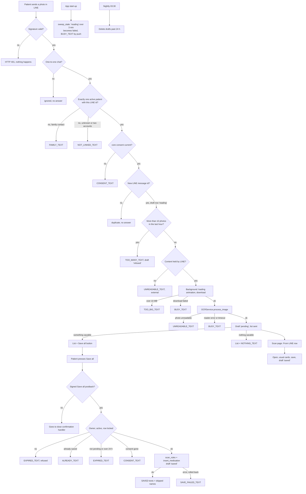

# Medicine photos over LINE

Built on 8 Nov 2026 on branch `version-4-competition`, in 7 commits: `0e2a14e` (scan rules in Python), `039bc0e` (draft table, loading animation, download), `3f7ff46` (who sent it, hourly limit, reading, the list), `db0dcfe` (Save all), `cbd95e7` (Scan page "From LINE" rows), `10bb757` (export, nightly clean-up, docs), `20c14f6` (an answer for every failure, the start-up sweep). Line numbers below are at HEAD `e96ecf6`.

## What it does

A patient takes a photo of a medicine bag or prescription and sends it to the LINE bot in a one-to-one chat. The server checks who sent it, reads the photo with the same OCR (text reading) service as the Scan page, and answers with a numbered list of the medicines it found. Under the list there is a button 「全部儲存 Save all」. When the patient presses it, the server saves the same medicines the Scan page would save, once, in one database transaction. Medicines that are already on the list, or that have a problem, are skipped and named in the answer. The photo itself is never stored; only the OCR result is kept, for 24 hours, and the Scan page also shows it as a "From LINE" row that opens into the usual cards.

## The flow

Every answer the patient sees is a LINE text. The exact texts are copied from `app/services/line_photo.py` (each one is Chinese, then " / ", then English).

1. **The patient sends a photo.** LINE calls the webhook `POST /api/notify/webhook/line`. The server checks the `X-Line-Signature` header first. A bad signature, or an empty `LINE_CHANNEL_SECRET`, gives HTTP 401 and nothing else happens.
2. **The webhook sends image events to `line_photo.receive`.** If `receive` itself crashes, the webhook logs it and goes on with the next event (the patient gets no answer).
3. **Only a one-to-one chat counts.** A photo sent in a group or a room is ignored silently (outcome `ignored`).
4. **Who sent it.** The sender's LINE id must belong to exactly one active patient account (`"user".line_id`).
   - A family contact (and no patient account) gets `FAMILY_TEXT`: 「只有病人本人可以用照片新增藥物。/ Only the patient can add medicines by photo.」 (outcome `family`).
   - An unknown sender gets `NOT_LINKED_TEXT`: 「請先在 App 裡連結您的 LINE。/ Please link your LINE in the app first.」 (outcome `not_linked`).
   - Two active accounts on the same LINE id also get `NOT_LINKED_TEXT`, but the log says `shared_line_id`.
   - These three answers go straight back with the reply token (`reply_text`), because there is no single patient to file them under.
5. **Consent.** The patient must have accepted the current terms (`core` consent). If not, they get `CONSENT_TEXT`: 「請先打開 App 並同意使用條款。/ Please open the app and accept the terms first.」 (outcome `consent`). Nothing is downloaded.
6. **One draft row per photo.** The server inserts a row in `line_photo_draft` with status `reading`. The row is keyed by LINE's message id, so if LINE delivers the same photo twice, the second one does nothing and gets no answer (outcome `duplicate`).
7. **10 photos an hour.** If this patient sent more than 10 photos in the last hour (this one included), the 11th gets `TOO_MANY_TEXT`: 「目前照片太多，請稍後再試。/ Too many photos right now, please try again later.」 (draft status `refused`, outcome `too_many`).
8. **The photo must be held by LINE.** A photo whose content is held somewhere else (`contentProvider` is not `line`) is not downloaded. The patient gets `UNREADABLE_TEXT`: 「我看不清楚這張照片，請在光線好的地方再拍一次。/ I couldn't read this photo. Please take it again in good light.」 (draft `failed`, outcome `external`).
9. **Reading starts in the background.** The webhook returns to LINE at once. A background task (`process`) does the rest.
10. **Loading animation and download.** The bot shows LINE's "…" loading animation in the chat for up to 60 seconds, then downloads the photo.
    - Bigger than 10 MB: `TOO_BIG_TEXT`: 「這張照片太大了，請傳小一點的照片。/ This photo is too large. Please send a smaller one.」 (outcome `too_large`).
    - Download failed: `BUSY_TEXT`: 「讀取服務現在忙碌中，請過幾分鐘再傳一次。/ The reader is busy right now. Please send the photo again in a few minutes.」 (outcome `download_failed`).
11. **OCR.** `OCRService.process_image` reads the photo. It may take at most `OCR_GEMINI_IMAGE_BUDGET` seconds (45) with a Gemini key, or `OLLAMA_TIMEOUT` (180) without one.
    - The photo cannot be read (codes `invalid_image`, `ocr_no_prescription_text`, `ocr_incomplete_schedule`): `UNREADABLE_TEXT` (outcome `unreadable`).
    - Any other OCR error, a timeout, or a crash in the reader: `BUSY_TEXT` (outcome `busy`).
    - Anything else that goes wrong (for example the database): `BUSY_TEXT` (outcome `error`). If even that answer fails, it is only logged.
12. **The list.** The result is stored in the draft (status `pending`) and the list is sent. It starts with 「我讀到 N 種藥：/ I read N medicines:」, then one numbered line per medicine (name, amount, times a day, days). A medicine that is already on the patient's list gets 「（已在清單中）」 after it; one with a problem (or a course that already ended) gets 「（請在 App 檢查）」. The last line is `FOOTER_TEXT`: 「要修改的話，請打開 App 的掃描頁。/ To change them, open the Scan page in the app.」.
    - If at least one medicine can be saved, a second message has the text 「按「全部儲存」就會加入您的藥物清單。」 and the button 「全部儲存 Save all」.
    - If nothing can be saved, the second message is `NOTHING_TEXT`: 「沒有可以直接儲存的藥，請打開 App 的掃描頁檢查。/ Nothing can be saved directly. Please check on the Scan page in the app.」 and there is no button.
13. **The patient presses Save all.** LINE sends a postback. The webhook first gives it to `line_photo.handle_save`. If the data is not a signed Save all postback (for example a family member's dose confirmation button, or tampered data), `handle_save` returns nothing and the postback goes on to the dose confirmation handler.
14. **Save all checks, in one transaction with the draft row locked:**
    - The draft does not exist, or the person who pressed is not the draft's owner, or the owner account is no longer active: `EXPIRED_TEXT`: 「這份清單已過期，請重新傳送照片。/ This list has expired. Please send the photo again.」 (outcome `refused`; answered straight back with the reply token).
    - Already saved: `ALREADY_TEXT`: 「已經儲存過了。/ Already saved.」 (outcome `already`). This is what a second press gets.
    - Not `pending`, or older than 24 hours: `EXPIRED_TEXT` (outcome `expired`).
    - Consent no longer current: `CONSENT_TEXT` (outcome `consent`).
15. **Saving.** The server rebuilds the Scan page's cards from the stored OCR result (`scan_rules`), skips duplicates and problems, and inserts each remaining medicine with the same function the Scan page's save uses (`insert_medication`). The draft becomes `saved`. The answer is one head line and one line per skipped medicine:
    - 0 saved: 「沒有新的藥需要儲存。/ Nothing new to save.」; 1 saved: 「已儲存 1 種藥。/ Saved 1 medicine.」; more: 「已儲存 {n} 種藥。/ Saved {n} medicines.」 with the number.
    - A skipped duplicate: 「{name}（已在清單中 / already saved）」; a skipped problem: 「{name}（請在 App 檢查 / check in the app）」 (`{name}` is the medicine's name).
    - If anything fails, everything of this press is rolled back and the patient gets `SAVE_FAILED_TEXT`: 「儲存失敗，請在 App 的掃描頁再試一次。/ Couldn't save. Please try again on the Scan page in the app.」 (outcome `failed`).
16. **How answers are sent.** Every answer that belongs to a patient goes into `notification_outbox` with kind `line_photo` and priority 1. The outbox dispatcher uses the free reply token while it is fresh (50 seconds after the webhook received the event), otherwise it pushes the message.
17. **A restart in the middle.** At start-up, `sweep_stale` finds drafts still `reading` 3 minutes after the photo came. Nothing will finish them, so they become `failed` (`interrupted`) and the patient gets `BUSY_TEXT` by push (only when the account still has a LINE id).
18. **The Scan page.** The page lists the patient's own `pending` drafts that are less than 24 hours old as rows "來自 LINE：N 種藥，HH:MM" / "From LINE: N medicines, HH:MM" with an Open button. Open fills the usual cards from the stored result (no photo is shown). When every ticked card saves, the page marks the draft `saved`, so the LINE button then answers `ALREADY_TEXT`. If the draft can no longer be opened, the page says 「這張 LINE 照片已無法開啟，可能已過期或已加入。」 / "This LINE photo can no longer be opened. It may have expired or been saved already."
19. **Export and clean-up.** The account export includes `line_photo_draft`. Every night at 03:30, and after a restore, drafts past their 24 hours are deleted.

## Diagram



## The code that runs it

### Step 1: the webhook checks LINE's signature

`app/routers/api_notify.py:76-93`

```python
@router.post("/webhook/line")
async def line_webhook(request: Request):
    """
    Handle incoming messages from LINE bot.
    Caregivers send verification codes here to link their LINE user_id.
    """
    received_at = datetime.datetime.now(datetime.timezone.utc)   # when we got it, never LINE's event timestamp
    raw_body = await request.body()

    # Verify X-Line-Signature before processing any events
    if not LINE_CHANNEL_SECRET:
        return JSONResponse({"error": "LINE channel secret not configured"}, status_code=401)
    signature = request.headers.get("X-Line-Signature", "")
    expected = base64.b64encode(
        hmac.new(LINE_CHANNEL_SECRET.encode(), raw_body, hashlib.sha256).digest()
    )
    if not hmac.compare_digest(expected, signature.encode("utf-8")):
        return JSONResponse({"error": "Invalid signature"}, status_code=401)
```

Every LINE call is checked with the channel secret before any event is read. `received_at` is the server's own time; it later decides how long the reply token is still fresh.

### Steps 2 and 13: images go to `receive`, postbacks to `handle_save` first

`app/routers/api_notify.py:103-120`

```python
        if event.get("type") == "postback":
            # A patient's Save all under a medicine photo's list (services/line_photo.py), else caregiver
            # confirmation buttons. Invalid or unauthorised postbacks
            # change nothing and get no reply (the reason is logged); replies go through the outbox.
            try:
                data = (event.get("postback") or {}).get("data", "")
                sender = (event.get("source") or {}).get("userId", "")
                token = _usable_reply_token(event)
                result = None
                async with pool.acquire() as conn:
                    if await line_photo.handle_save(conn, data, sender, token, received_at) is None:
                        result = await dose_confirmation.handle_postback(
                            conn, data, sender, token, received_at=received_at)
                if result is not None:
                    log.info("[LINE] postback applied: %s", result.get("status"))
            except Exception as exc:
                print(f"[LINE] postback handling failed: {exc}")
            continue
```

`app/routers/api_notify.py:134-141`

```python
        msg = event["message"]
        if msg.get("type") == "image":
            # A medicine photo (services/line_photo.py): checked here, read in the background.
            try:
                await line_photo.receive(event, received_at)
            except Exception as exc:
                log.warning("[LINE] photo handling failed: %s", type(exc).__name__)
            continue
```

A postback is first offered to `line_photo.handle_save`; only when that returns `None` (not a Save all) does the dose confirmation handler see it. An image event goes to `line_photo.receive`; a crash there is logged by its class name only.

`_usable_reply_token` (`app/routers/api_notify.py:40-45`) gives a reply token only in a one-to-one chat:

```python
def _usable_reply_token(event: dict) -> str | None:
    """A reply lands in the chat the event came from: use the token only in a one-to-one chat, so an answer
    typed or pressed in a group or room is never shown to the whole group (it goes by push instead)."""
    if (event.get("source") or {}).get("type") != "user":
        return None
    return event.get("replyToken")
```

### The fixed values and every message text

`app/services/line_photo.py:32-41`

```python
KIND = "line_photo"
PRIORITY = 1
MAX_BYTES = 10 * 1024 * 1024
PER_HOUR = 10
LOADING_SECONDS = 60
STALE_MINUTES = 3        # a read still `reading` this long after its photo came was cut off (a restart, a shutdown)
SAVE_ACTION = "line_photo_save"
_SIG_HEX = 16
_MAX_DATA = 300          # LINE's limit on postback data
_MAX_TEXT = 5000         # LINE's limit on a text message
```

`app/services/line_photo.py:43-61`

```python
NOT_LINKED_TEXT = "請先在 App 裡連結您的 LINE。/ Please link your LINE in the app first."
FAMILY_TEXT = "只有病人本人可以用照片新增藥物。/ Only the patient can add medicines by photo."
CONSENT_TEXT = "請先打開 App 並同意使用條款。/ Please open the app and accept the terms first."
TOO_MANY_TEXT = "目前照片太多，請稍後再試。/ Too many photos right now, please try again later."
TOO_BIG_TEXT = "這張照片太大了，請傳小一點的照片。/ This photo is too large. Please send a smaller one."
UNREADABLE_TEXT = "我看不清楚這張照片，請在光線好的地方再拍一次。/ I couldn't read this photo. Please take it again in good light."
BUSY_TEXT = "讀取服務現在忙碌中，請過幾分鐘再傳一次。/ The reader is busy right now. Please send the photo again in a few minutes."
FOOTER_TEXT = "要修改的話，請打開 App 的掃描頁。/ To change them, open the Scan page in the app."
NOTHING_TEXT = "沒有可以直接儲存的藥，請打開 App 的掃描頁檢查。/ Nothing can be saved directly. Please check on the Scan page in the app."
SAVED_TEXT = "已儲存 {n} 種藥。/ Saved {n} medicines."
SAVED_ONE_TEXT = "已儲存 1 種藥。/ Saved 1 medicine."
SAVED_NONE_TEXT = "沒有新的藥需要儲存。/ Nothing new to save."
ALREADY_TEXT = "已經儲存過了。/ Already saved."
EXPIRED_TEXT = "這份清單已過期，請重新傳送照片。/ This list has expired. Please send the photo again."
SAVE_FAILED_TEXT = "儲存失敗，請在 App 的掃描頁再試一次。/ Couldn't save. Please try again on the Scan page in the app."
SKIPPED_DUPLICATE = "{name}（已在清單中 / already saved）"
SKIPPED_CHECK = "{name}（請在 App 檢查 / check in the app）"
SAVE_LABEL = "全部儲存 Save all"
BUTTON_TEXT = "按「全部儲存」就會加入您的藥物清單。"
```

`app/services/line_photo.py:63-67`

```python
# OCR codes that mean the photo itself could not be read; every other failure is the reader's.
UNREADABLE_CODES = frozenset({"invalid_image", "ocr_no_prescription_text", "ocr_incomplete_schedule"})
SLOT_WORDS = {"morning": "早上", "noon": "中午", "night": "晚上", "bedtime": "睡前"}
DUPLICATE_MARK = "（已在清單中）"
CHECK_MARK = "（請在 App 檢查）"
```

All limits and all patient texts live here. `UNREADABLE_CODES` decides which OCR errors mean "the photo is bad" (answered with `UNREADABLE_TEXT`) and which mean "the reader is busy" (`BUSY_TEXT`).

### Steps 3 and 4: one-to-one chat, one active patient, family refused

`app/services/line_photo.py:189-213`

```python
async def receive(event: dict, received_at: datetime) -> str:
    """Handle one image event. Returns its outcome; `reading` means `process` now runs in the background and logs
    the photo's one line when it ends (every other outcome is logged here)."""
    source = event.get("source") or {}
    sender = source.get("userId") or ""
    if source.get("type") != "user" or not sender:
        return _logged("ignored")
    message = event.get("message") or {}
    message_id = str(message.get("id") or "")
    reply_token = event.get("replyToken")
    line_svc = LineService.get_instance()

    async with get_pool().acquire() as conn:
        patients = await conn.fetch('SELECT u_id FROM "user" WHERE line_id = $1 AND user_active = TRUE', sender)
        family = not patients and await conn.fetchval(
            "SELECT 1 FROM family_contacts WHERE line_id = $1 AND relationship IS DISTINCT FROM 'user' LIMIT 1",
            sender) is not None
    if len(patients) != 1:
        if family:
            outcome, text = "family", FAMILY_TEXT
        else:   # two active accounts on one LINE id get the unlinked answer, but their own outcome in the log
            outcome, text = ("shared_line_id" if patients else "not_linked"), NOT_LINKED_TEXT
        await asyncio.to_thread(line_svc.reply_text, reply_token, sender, text)
        return _logged(outcome)
    u_id = patients[0]["u_id"]
```

The sender must be a `user` source (a one-to-one chat). The query looks for active patient accounts with this LINE id; the family check runs only when there is no patient. These refusals are sent at once with `reply_text`, because no patient owns them.

### Step 5: the consent check

`app/services/line_photo.py:215-220`

```python
    if not consent_service.is_current(await consent_service.get_state(u_id), "core"):
        async with get_pool().acquire() as conn:
            await _answer(conn, u_id, sender, [_text(CONSENT_TEXT)], f"line_photo:msg:{message_id}:consent",
                          reply_token, received_at)
        outbox.wake()
        return _logged("consent")
```

Without current `core` consent the patient gets `CONSENT_TEXT` through the outbox, and no draft row is written.

### Steps 6, 7, 8 and 9: the draft row, the hourly limit, external content, the background task

`app/services/line_photo.py:222-240`

```python
    draft_id = str(uuid.uuid4())
    async with get_pool().acquire() as conn:
        inserted = await conn.fetchval(
            "INSERT INTO line_photo_draft (draft_id, u_id, line_message_id) VALUES ($1::uuid, $2, $3) "
            "ON CONFLICT (line_message_id) DO NOTHING RETURNING draft_id",
            draft_id, u_id, message_id)
        if inserted is None:
            return _logged("duplicate")
        recent = await conn.fetchval(
            "SELECT count(*) FROM line_photo_draft WHERE u_id = $1 AND created_at > NOW() - INTERVAL '1 hour'",
            u_id)
    if recent > PER_HOUR:
        return await _fail(draft_id, u_id, sender, reply_token, received_at, "too_many", "too_many",
                           TOO_MANY_TEXT, status="refused")
    if (message.get("contentProvider") or {}).get("type") != "line":
        return await _fail(draft_id, u_id, sender, reply_token, received_at, "external", "external",
                           UNREADABLE_TEXT)
    _spawn(process(draft_id, u_id, sender, message_id, reply_token, received_at))
    return "reading"
```

`ON CONFLICT (line_message_id) DO NOTHING` makes a repeated delivery do nothing. The hour count includes the new row, so `recent > PER_HOUR` refuses the 11th photo. `_spawn` starts `process` in the background, so LINE gets its webhook answer quickly.

The table (`sql/init.sql:615-628`):

```sql
-- LINE medicine photo (8 Nov 2026): one row per photo a patient sends; the photo itself is never kept.
CREATE TABLE IF NOT EXISTS line_photo_draft (
    draft_id UUID PRIMARY KEY,
    u_id INTEGER NOT NULL REFERENCES "user"(u_id) ON DELETE CASCADE,
    line_message_id VARCHAR(64) NOT NULL UNIQUE,
    status VARCHAR(10) NOT NULL DEFAULT 'reading'
        CHECK (status IN ('reading', 'pending', 'saved', 'failed', 'refused')),
    result JSONB,
    error_code VARCHAR(40),
    created_at TIMESTAMPTZ NOT NULL DEFAULT NOW(),
    expires_at TIMESTAMPTZ NOT NULL DEFAULT NOW() + INTERVAL '24 hours',
    saved_at TIMESTAMPTZ
);
CREATE INDEX IF NOT EXISTS idx_line_photo_draft_user ON line_photo_draft(u_id, created_at DESC);
```

### How a failure is answered (`_answer` and `_fail`)

`app/services/line_photo.py:167-184`

```python
async def _answer(conn, u_id: int, sender: str, messages: list[dict], dedupe_key: str,
                  reply_token: str | None, received_at: datetime) -> None:
    await outbox.enqueue(conn, u_id=u_id, recipient_line_id=sender, kind=KIND, priority=PRIORITY,
                         messages=messages, dedupe_key=dedupe_key, reply_token=reply_token,
                         received_at=received_at)


async def _fail(draft_id: str, u_id: int, sender: str, reply_token: str | None, received_at: datetime,
                outcome: str, error_code: str, text: str, status: str = "failed", quiet: bool = False) -> str:
    """Mark the draft and answer `text`. `quiet`: the caller logs the photo's one line itself."""
    async with get_pool().acquire() as conn:
        async with conn.transaction():
            await conn.execute("UPDATE line_photo_draft SET status = $2, error_code = $3 WHERE draft_id = $1",
                               draft_id, status, error_code)
            await _answer(conn, u_id, sender, [_text(text)], f"line_photo:{draft_id}:{outcome}",
                          reply_token, received_at)
    outbox.wake()
    return outcome if quiet else _logged(outcome)
```

`_answer` puts the messages into the outbox with kind `line_photo`. `_fail` marks the draft and answers in one transaction; the dedupe key (draft id plus outcome) stops the same answer from being queued twice.

### Step 10: loading animation and download (in `line_service.py`)

`app/services/line_service.py:102-122`

```python
    def start_loading(self, chat_id: str, seconds: int = 60) -> bool:
        """Show LINE's loading animation in a one-to-one chat (5 to 60 seconds, multiples of 5).

        True when LINE accepted it. Never raises. A failure logs only LINE's HTTP status or the exception's class
        name, never the chat id or the token.
        """
        if not LineService._available or not chat_id:
            return False
        headers = {
            "Content-Type": "application/json",
            "Authorization": f"Bearer {LINE_CHANNEL_ACCESS_TOKEN}",
        }
        try:
            resp = requests.post(LINE_LOADING_URL, json={"chatId": chat_id, "loadingSeconds": seconds},
                                 headers=headers, timeout=LOADING_TIMEOUT_SECONDS)
        except Exception as exc:
            log.warning("[LINE] loading animation failed: %s", type(exc).__name__)
            return False
        if not 200 <= resp.status_code < 300:
            log.warning("[LINE] loading animation failed: %s", resp.status_code)
            return False
```

`app/services/line_service.py:134-150`

```python
        headers = {"Authorization": f"Bearer {LINE_CHANNEL_ACCESS_TOKEN}"}
        resp = None
        try:
            resp = requests.get(LINE_CONTENT_URL.format(message_id=message_id), headers=headers,
                                stream=True, timeout=CONTENT_TIMEOUT_SECONDS)
            if resp.status_code != 200:
                log.warning("[LINE] content download failed: %s", resp.status_code)
                return "failed", None
            data = bytearray()
            for chunk in resp.iter_content(chunk_size=CONTENT_CHUNK_BYTES):
                data += chunk
                if len(data) > max_bytes:
                    return "too_large", None
            return "ok", bytes(data)
        except Exception as exc:
            log.warning("[LINE] content download failed: %s", type(exc).__name__)
            return "failed", None
```

`start_loading` shows LINE's "…" animation. `get_content` reads the photo in 64 KB chunks and stops as soon as it passes the size limit, so a huge file is never held whole. Neither one ever raises, and neither logs an id or the token.

### Steps 10 and 11: reading in the background

`app/services/line_photo.py:245-258`

```python
async def process(draft_id: str, u_id: int, sender: str, message_id: str, reply_token: str | None,
                  received_at: datetime) -> str:
    """Download, read and answer one photo (a background task). Returns the outcome it logged."""
    try:
        return await _process(draft_id, u_id, sender, message_id, reply_token, received_at)
    except Exception as exc:   # a database failure or an unexpected OCR value: logged by type only, never the details
        error = type(exc).__name__
    try:   # the patient still gets an answer; once only, a second failure is only logged
        await _fail(draft_id, u_id, sender, reply_token, received_at, "error", "error", BUSY_TEXT, quiet=True)
    except Exception as again:
        log.warning("[LINE] photo: error (%s), not answered (%s)", error, type(again).__name__)
        return "error"
    log.warning("[LINE] photo: error (%s)", error)
    return "error"
```

`process` wraps the real work. Any unexpected error still gives the patient `BUSY_TEXT`; if that answer also fails, it is only logged.

`app/services/line_photo.py:266-285`

```python
    line_svc = LineService.get_instance()
    await asyncio.to_thread(line_svc.start_loading, sender, LOADING_SECONDS)
    status, photo = await asyncio.to_thread(line_svc.get_content, message_id, MAX_BYTES)
    if status == "too_large":
        return await fail("too_large", "too_large", TOO_BIG_TEXT)
    if status != "ok":
        return await fail("download_failed", "download_failed", BUSY_TEXT)

    svc = OCRService.get_instance()
    timeout = OCR_GEMINI_IMAGE_BUDGET if svc.gemini_api_key else OLLAMA_TIMEOUT
    try:
        result = await asyncio.wait_for(asyncio.to_thread(svc.process_image, photo), timeout)
    except OCRServiceError as exc:
        if exc.code in UNREADABLE_CODES:
            return await fail("unreadable", exc.code, UNREADABLE_TEXT)
        return await fail("busy", exc.code, BUSY_TEXT)
    except asyncio.TimeoutError:
        return await fail("busy", "ocr_timeout", BUSY_TEXT)
    except Exception:
        return await fail("busy", "ocr_error", BUSY_TEXT)
```

The download result and every OCR failure are turned into one outcome and one patient text. The OCR runs in a thread with a time limit: `OCR_GEMINI_IMAGE_BUDGET` with a Gemini key, else `OLLAMA_TIMEOUT`.

### Step 12: store the result and send the list

`app/services/line_photo.py:287-296`

```python
    async with get_pool().acquire() as conn:
        async with conn.transaction():
            await conn.execute(
                "UPDATE line_photo_draft SET status = 'pending', result = $2::jsonb WHERE draft_id = $1",
                draft_id, json.dumps(result, ensure_ascii=False))
            names = await _active_names(conn, u_id)
            messages = list_messages(result, memory.local_today().isoformat(), names, draft_id)
            await _answer(conn, u_id, sender, messages, f"line_photo:{draft_id}:read", reply_token, received_at)
    outbox.wake()
    return _logged("read")
```

The OCR result is stored as JSON (the photo is not), the draft becomes `pending`, and the list is queued in the same transaction.

`app/services/line_photo.py:139-162`

```python
def list_messages(result: dict, today: str, active_names: list[str], draft_id: str) -> list[dict]:
    drafts = scan_rules.mark_duplicates(
        [scan_rules.draft_from(med, result, today) for med in scan_rules.medicines_of(result)], active_names)
    lines = [f"我讀到 {len(drafts)} 種藥：/ I read {len(drafts)} medicines:"]
    savable = 0
    for index, draft in enumerate(drafts, 1):
        line = _line(index, draft)
        if draft.get("duplicate"):
            line += DUPLICATE_MARK
        elif not draft["include"] or scan_rules.draft_problem(draft, today) is not None:
            line += CHECK_MARK
        else:
            savable += 1
        lines.append(line)
    lines.append(FOOTER_TEXT)
    messages = [_text("\n".join(lines))]
    if savable:
        messages.append({"type": "template", "altText": BUTTON_TEXT, "template": {
            "type": "buttons", "text": BUTTON_TEXT,
            "actions": [{"type": "postback", "label": SAVE_LABEL, "displayText": SAVE_LABEL,
                         "data": sign_save(draft_id)}]}})
    else:
        messages.append(_text(NOTHING_TEXT))
    return messages
```

`list_messages` builds the same drafts as the Scan page (`scan_rules.draft_from` and `mark_duplicates`), marks duplicates and problems, and adds the Save all button only when something can be saved.

### The signed Save all button (`sign_save` and `verify_save`)

`app/services/line_photo.py:90-96`

```python
def _save_signature(draft_id: str) -> str:
    message = f"{SAVE_ACTION}|{draft_id}".encode("utf-8")
    return hmac.new(SECRET_KEY.encode("utf-8"), message, hashlib.sha256).hexdigest()[:_SIG_HEX]


def sign_save(draft_id: str) -> str:
    return f"action={SAVE_ACTION}&id={draft_id}&s={_save_signature(draft_id)}"
```

`app/services/line_photo.py:99-118`

```python
def verify_save(data: str) -> str | None:
    """The draft id of an untampered Save all postback, else None."""
    if not isinstance(data, str) or len(data) > _MAX_DATA:
        return None
    try:
        pairs = parse_qsl(data, keep_blank_values=True, strict_parsing=True)
    except ValueError:
        return None
    fields = dict(pairs)
    if len(pairs) != len(fields) or set(fields) != {"action", "id", "s"} or fields["action"] != SAVE_ACTION:
        return None
    draft_id = fields["id"]
    try:
        if str(uuid.UUID(draft_id)) != draft_id:
            return None
    except ValueError:
        return None
    if not hmac.compare_digest(_save_signature(draft_id).encode(), fields["s"].encode("utf-8")):
        return None
    return draft_id
```

The postback data is `action=line_photo_save&id=<draft id>&s=<signature>`. The signature is the first 16 hex characters of an HMAC-SHA256 with `SECRET_KEY`. `verify_save` accepts only exactly these three fields, a real UUID and a matching signature, so changed data is never treated as a Save all.

### Step 14: Save all checks

`app/services/line_photo.py:365-376`

```python
    draft_id = verify_save(data)
    if draft_id is None:
        return None
    dedupe_key = f"line_photo:{draft_id}:save:{received_at.isoformat()}"
    owner = None
    try:
        async with conn.transaction():
            row = await conn.fetchrow(
                'SELECT d.*, u.line_id, u.user_active FROM line_photo_draft d JOIN "user" u USING (u_id) '
                "WHERE d.draft_id = $1 FOR UPDATE OF d", draft_id)
            if row is None or row["line_id"] != sender or not row["user_active"]:
                outcome, text = "refused", EXPIRED_TEXT
```

`app/services/line_photo.py:377-392`

```python
            else:
                owner = row["u_id"]
                if row["status"] == "saved":
                    outcome, text = "already", ALREADY_TEXT
                elif row["status"] != "pending" or row["expires_at"] <= datetime.now(timezone.utc):
                    outcome, text = "expired", EXPIRED_TEXT
                elif not consent_service.is_current(await consent_service.fetch_state(conn, owner), "core"):
                    outcome, text = "consent", CONSENT_TEXT
                else:
                    result = row["result"]
                    text = await _save_drafts(conn, owner, json.loads(result) if isinstance(result, str) else result)
                    await conn.execute(
                        "UPDATE line_photo_draft SET status = 'saved', saved_at = NOW() WHERE draft_id = $1",
                        draft_id)
                    outcome = "saved"
                await _answer(conn, owner, sender, [_text(text)], dedupe_key, reply_token, received_at)
```

`FOR UPDATE OF d` locks the draft row, so two presses at the same moment run one after the other and the second sees `saved`. The owner, the status, the 24 hours and the consent are all checked inside the same transaction as the save.

### Step 15: what is saved

`app/services/line_photo.py:335-358`

```python
async def _save_drafts(conn, u_id: int, result: dict) -> str:
    """Insert every medicine the Scan page would save as it stands; the answer names the ones left out."""
    today = memory.local_today().isoformat()
    drafts = scan_rules.mark_duplicates(
        [scan_rules.draft_from(med, result, today) for med in scan_rules.medicines_of(result)],
        await _active_names(conn, u_id))
    saved, skipped = 0, []
    for draft in drafts:
        name = draft["name"].strip()
        if draft.get("duplicate"):
            skipped.append(SKIPPED_DUPLICATE.format(name=name))
            continue
        if not draft["include"] or scan_rules.draft_problem(draft, today) is not None:
            skipped.append(SKIPPED_CHECK.format(name=name))
            continue
        try:
            payload = MedicationPayload(**scan_rules.medication_payload(draft, result))
        except ValidationError:
            skipped.append(SKIPPED_CHECK.format(name=name))
            continue
        await insert_medication(conn, u_id, payload)
        saved += 1
    head = SAVED_NONE_TEXT if saved == 0 else SAVED_ONE_TEXT if saved == 1 else SAVED_TEXT.format(n=saved)
    return "\n".join([head, *skipped])
```

For each medicine: a duplicate or a draft with a problem is skipped and named; otherwise the Scan page's request body is built (`scan_rules.medication_payload`), checked by the same `MedicationPayload` model as `POST /api/medications`, and inserted.

`app/services/line_photo.py:393-406`

```python
    except Exception as exc:   # rolled back: nothing of this press is stored. Logged by type only.
        log.warning("[LINE] photo save: failed (%s)", type(exc).__name__)
        if owner is None:
            await asyncio.to_thread(LineService.get_instance().reply_text, reply_token, sender, SAVE_FAILED_TEXT)
        else:
            async with conn.transaction():
                await _answer(conn, owner, sender, [_text(SAVE_FAILED_TEXT)], dedupe_key, reply_token, received_at)
            outbox.wake()
        return "failed"
    if owner is None:
        await asyncio.to_thread(LineService.get_instance().reply_text, reply_token, sender, text)
    else:
        outbox.wake()
    return _save_logged(outcome)
```

If anything in the transaction fails, it is rolled back and the patient gets `SAVE_FAILED_TEXT`. Answers to a press with no owner go straight back with `reply_text`; the others go through the outbox.

### The Scan page's rules in Python (`scan_rules.py`)

`app/services/scan_rules.py:1-9`

```python
"""The Scan page's save rules (frontend_source/src/lib/scan.ts), ported line by line so the server builds the very
drafts and POST /api/medications bodies the page builds from an OCR result. Pure functions; dicts in the TypeScript
shapes; `today` is an ISO 'YYYY-MM-DD' string. tests/scan_parity.json, made from scan.ts by
frontend_source/tests/scan_parity.gen.ts, holds the two equal (tests/test_scan_rules.py and scan.unit.ts).

JavaScript semantics kept on purpose: Math.round rounds halves up; numbers print as String() prints them; Number()
parses text as JS does; a key that is `undefined` in TypeScript is left out of the dict (JSON.stringify drops it),
while `null` stays None; new Date(y, m - 1, d + days) rolls an impossible date over; dates compare as text; \\s and
trim() use JavaScript's whitespace."""
```

`app/services/scan_rules.py:230-238`

```python
def mark_duplicates(drafts: list[dict], active_names: list[str]) -> list[dict]:
    marked = []
    for draft in drafts:
        if draft["status"] == "saved" or draft.get("duplicate") or \
                not any(same_name(name, draft["name"]) for name in active_names):
            marked.append(draft)
        else:
            marked.append({**draft, "duplicate": True, "include": False})
    return marked
```

`scan_rules.py` is a line-by-line Python copy of `frontend_source/src/lib/scan.ts`. `mark_duplicates` compares names the way the page does (same letters after Unicode normalising, ignoring case, spaces and dots). `draft_problem` (`scan_rules.py:241-266`) and `medication_payload` (`scan_rules.py:288-338`) are the page's checks and its save body.

The insert itself is shared with the Scan page's save (`app/routers/api_medications.py:440-454`):

```python
async def insert_medication(conn, u_id: int, payload: MedicationPayload) -> dict:
    """Store one medicine and its dose rows: POST /api/medications and LINE's Save all (services/line_photo.py).
    The caller owns the connection and any transaction."""
    remaining = payload.pills_remaining if payload.pills_remaining is not None else Decimal(payload.total_pills)
    dose_form = payload.dose_form or "solid_oral"
    units_per_dose = payload.units_per_dose if payload.units_per_dose is not None else Decimal("1")
    med_id = await conn.fetchval(
        """
        INSERT INTO medication
            (u_id, med_name, dosage, pill_prescribed, pills_remaining,
             instructions, warning, pill_description, use_before,
             is_active, schedule_time, prescription_meta, dose_form, units_per_dose,
             min_interval_minutes, max_daily_doses)
        VALUES ($1,$2,$3,$4,$5,$6,$7,$8,$9,$10,$11,$12,$13,$14,$15,$16)
        RETURNING med_id
```

### Step 16: answers through the outbox

`app/services/outbox.py:34-52`

```python
async def enqueue(conn, *, u_id: int, recipient_line_id: str, kind: str, priority: int,
                  messages: list[dict], dedupe_key: str, recipient_contact_id: int | None = None,
                  reply_token: str | None = None, received_at: datetime.datetime | None = None) -> bool:
    payload = {"messages": messages}
    if reply_token:
        # LINE's reply token is valid about a minute and works once: the dispatcher tries it while it is fresh.
        from app.services.outbox_dispatcher import REPLY_WINDOW_SECONDS
        received_at = received_at or datetime.datetime.now(datetime.timezone.utc)
        payload["reply_token"] = reply_token
        payload["reply_until"] = (received_at + datetime.timedelta(seconds=REPLY_WINDOW_SECONDS)).isoformat()
    inserted = await conn.fetchval(
        "INSERT INTO notification_outbox (dedupe_key, u_id, recipient_contact_id, recipient_line_id, "
        "kind, priority, payload) VALUES ($1,$2,$3,$4,$5,$6,$7::jsonb) "
        "ON CONFLICT (dedupe_key) DO NOTHING RETURNING outbox_id",
        dedupe_key, u_id, recipient_contact_id, recipient_line_id, kind, priority,
        json.dumps(payload, ensure_ascii=False))
    if inserted is not None and priority == 0:
        wake()
    return inserted is not None
```

`app/services/outbox_dispatcher.py:63-80`

```python
async def _send(row, now: datetime.datetime) -> dict:
    payload = row["payload"]
    if isinstance(payload, str):
        payload = json.loads(payload)
    service = LineService.get_instance()
    loop = asyncio.get_running_loop()
    try:
        if _reply_is_fresh(payload, now):
            # Free reply first; anything but 'accepted' goes to push in this same attempt (the token is spent).
            replied = await loop.run_in_executor(None, service.reply_messages, payload["reply_token"],
                                                 payload["messages"])
            if replied.get("status") == "accepted":
                return replied
        return await loop.run_in_executor(
            None, functools.partial(service.push_messages, row["recipient_line_id"], payload["messages"],
                                    retry_key(row["outbox_id"]), kind=row["kind"]))
    except Exception as exc:
        return {"status": "failed", "http_status": None, "request_id": None, "error": str(exc)}
```

The outbox keeps the reply token and its deadline (`received_at` + 50 s). The dispatcher replies while the token is fresh (free, does not count toward the monthly quota), and pushes otherwise.

### Step 17: the start-up sweep

`app/services/line_photo.py:299-319`

```python
async def sweep_stale(conn) -> int:
    """At start-up: drafts still `reading` STALE_MINUTES after their photo came were cut off (a restart or a shutdown
    mid-read; nothing will finish them). Marks them failed (`interrupted`) and answers the busy text by push to the
    owner's current LINE id (none when it is unlinked since). Returns how many were marked."""
    async with conn.transaction():
        rows = await conn.fetch(
            "UPDATE line_photo_draft SET status = 'failed', error_code = 'interrupted' "
            "WHERE status = 'reading' AND created_at < NOW() - make_interval(mins => $1) "
            'RETURNING draft_id, u_id, (SELECT line_id FROM "user" u WHERE u.u_id = line_photo_draft.u_id) AS line_id',
            STALE_MINUTES)
        answered = 0
        for row in rows:
            if row["line_id"] is None:
                continue
            await _answer(conn, row["u_id"], row["line_id"], [_text(BUSY_TEXT)],
                          f"line_photo:{row['draft_id']}:interrupted", None, None)
            answered += 1
    if answered:
        outbox.wake()
    log.info("[LINE] photo: %d interrupted reads marked failed", len(rows))
    return len(rows)
```

`app/main.py:64-67`

```python
        try:   # LINE photo reads a restart or a shutdown cut off: marked failed and answered (never stops the start)
            await line_photo.sweep_stale(conn)
        except Exception as error:
            log.warning("[LINE] photo: the start-up sweep failed (%s)", type(error).__name__)
```

At every start the app marks reads that a restart cut off as `failed` with `interrupted` and answers them by push. A failing sweep never stops the start.

### Step 18: the Scan page's "From LINE" rows

The API (`app/routers/api_line_drafts.py:10-13`, `29-37` and `52-62`):

```python
router = APIRouter(prefix="/api/line-drafts")

# Only the caller's own drafts that are still waiting and not past their 24 hours.
_LIVE = "u_id = $1 AND status = 'pending' AND expires_at > NOW()"
```

```python
@router.get("")
async def list_drafts(user: dict = Depends(get_consented_user)):
    async with get_pool().acquire() as conn:
        rows = await conn.fetch(
            f"SELECT draft_id, created_at, result FROM line_photo_draft WHERE {_LIVE} ORDER BY created_at DESC",
            user["u_id"],
        )
    return [{"id": str(r["draft_id"]), "created_at": r["created_at"].isoformat(), "count": _count(_result(r))}
            for r in rows]
```

```python
@router.post("/{draft_id}/saved")
async def mark_saved(draft_id: uuid.UUID, user: dict = Depends(get_consented_user)):
    async with get_pool().acquire() as conn:
        row = await conn.fetchrow(
            f"UPDATE line_photo_draft SET status = 'saved', saved_at = NOW() WHERE draft_id = $2 AND {_LIVE} "
            "RETURNING draft_id",
            user["u_id"], draft_id,
        )
    if row is None:
        raise HTTPException(status_code=404, detail="not_found")
    return {"saved": True}
```

All three routes need current consent (`get_consented_user`) and only ever see the caller's own `pending` drafts that are less than 24 hours old. Another person's draft is a 404.

The page (`frontend_source/src/pages/Scan.tsx:653-671`):

```tsx
      {/* Medicine photos sent on LINE, read and waiting */}
      {lineDrafts.length > 0 && (
        <div className="space-y-2">
          {lineDrafts.map((row) => (
            <div key={row.id} className="flex items-center justify-between gap-3 p-3 bg-green-50 border border-green-200 rounded-xl">
              <span className="text-base text-gray-900">
                {t('scan.fromLine', { count: row.count, time: clockTime(row.created_at) })}
              </span>
              <button
                onClick={() => openLineDraft(row.id)}
                className="px-4 py-2 bg-[#0057B8] text-white text-base rounded-xl font-medium hover:bg-[#003D82] active:scale-95 transition-all touch-target-large"
              >
                {t('scan.openLine')}
              </button>
            </div>
          ))}
          {lineError && <p className="text-sm text-red-600">{lineError}</p>}
        </div>
      )}
```

`frontend_source/src/pages/Scan.tsx:203-221`

```tsx
  const openLineDraft = async (id: string) => {
    setLineError('');
    try {
      const res = await fetch(`/api/line-drafts/${id}`, { headers: getAuthHeaders() });
      if (!res.ok) throw new Error(String(res.status));
      const body = await res.json();
      const scan = body.result as ScanResult;
      const today = isoDate(new Date());
      stream?.getTracks().forEach((t) => t.stop());
      setStream(null);
      setCapturedImage(null);
      setParseError('');
      setAddError('');
      scrollToCardsRef.current = true;
      setParsed(scan);
      setLineOpenId(id);
      setDrafts(medicinesOf(scan).map((med) => draftFrom(med, scan, today)));
      const existing = await activeMedicineNames(getAuthHeaders());
      if (existing.length > 0) setDrafts((current) => markDuplicates(current, existing));
```

`frontend_source/src/pages/Scan.tsx:302-315`

```tsx
    // A LINE list is marked saved only when every ticked card saved; a failed card keeps it for another try.
    if (lineOpenId && everyTickedSaved) {
      try {
        const res = await fetch(`/api/line-drafts/${lineOpenId}/saved`, { method: 'POST', headers });
        if (res.ok) {
          setLineDrafts((rows) => rows.filter((row) => row.id !== lineOpenId));
          setLineOpenId(null);
        } else {
          console.warn('Marking the LINE list saved failed', res.status);
        }
      } catch (error) {
        console.warn('Marking the LINE list saved failed', error);
      }
    }
```

Each waiting draft is a green row with an Open button. Open fills the same cards a fresh scan gives. Only when every ticked card saved is the draft marked `saved`; a failed card keeps the row for another try.

### Step 19: export and nightly clean-up

`app/routers/api_account.py:21-27`

```python
EXPORT_TABLES = (
    "user", "detail", "medication", "medication_supply", "intake", "emotion", "family_contacts",
    "notification_settings", "notification", "login_log", "monitor_event", "consent",
    "conversation", "conversation_turn", "patient_memory", "patient_memory_deleted",
    "dose_confirmation", "monitor_extra_event", "reachy_device", "reachy_task", "notification_outbox",
    "dose_video", "dose_video_link", "dose_emotion", "line_photo_draft",
)
```

`app/jobs/conversation_retention_job.py:19-31`

```python
async def run_retention(conn) -> None:
    await conn.execute(
        "DELETE FROM conversation_turn WHERE "
        "(NOT flagged AND created_at < NOW() - make_interval(days => $1)) OR "
        "(flagged AND created_at < NOW() - make_interval(days => $2))",
        TRANSCRIPT_DAYS, SAFETY_QUOTE_DAYS)
    await conn.execute(
        "DELETE FROM patient_memory WHERE kind = 'event' AND event_date < (NOW() AT TIME ZONE $1)::date - $2::int",
        config.MEDCARE_TIMEZONE, EVENT_KEEP_DAYS)
    await conn.execute(
        "DELETE FROM patient_memory_deleted WHERE deleted_at < NOW() - make_interval(days => $1)", TOMBSTONE_DAYS)
    # LINE medicine photo drafts (24 h); a draft stuck at 'reading' after a restart carries expires_at too.
    await conn.execute("DELETE FROM line_photo_draft WHERE expires_at < NOW()")
```

`app/jobs/scheduler.py:69-74`

```python
    scheduler.add_job(
        purge_old_transcripts,
        CronTrigger(hour=3, minute=30),
        id="conversation_retention",
        replace_existing=True,
    )
```

`line_photo_draft` is part of the account export. `run_retention` deletes drafts past their 24 hours every night at 03:30 (and the restore replay, `app/ops/replay_ledger.py:20-21`, runs it too). A draft stuck at `reading` also has an `expires_at`, so it goes the same way.

### The golden file `tests/scan_parity.json`

`frontend_source/tests/scan_parity.gen.ts:1-4`

```ts
// The golden file that holds app/services/scan_rules.py equal to lib/scan.ts. Regenerate after any change to scan.ts:
//   node --experimental-strip-types tests/scan_parity.gen.ts
// It writes ../tests/scan_parity.json (the repo's tests folder), read by tests/test_scan_rules.py and by
// 'the golden file matches scan.ts' in scan.unit.ts. Fixtures as in scan.unit.ts (made-up names and numbers).
```

The generator runs the real `scan.ts` on fixed test cases and writes the drafts, problems and save bodies to `tests/scan_parity.json`. `tests/test_scan_rules.py` checks that `scan_rules.py` gives the same answers, and `frontend_source/tests/scan.unit.ts` checks that the file still matches `scan.ts`. So if someone changes only one side, a test fails. **Rule:** change `scan.ts` and `scan_rules.py` together, then run `cd frontend_source; node --experimental-strip-types tests/scan_parity.gen.ts`.

## Settings

No new environment variables were added for this feature. These values change how it behaves:

| Name | Default | Where it is read | What it does |
|---|---|---|---|
| `PER_HOUR` (constant) | 10 | `app/services/line_photo.py:35`, used at `:233` | Photos per patient per hour; the next one is refused. |
| `MAX_BYTES` (constant) | 10 MB | `app/services/line_photo.py:34`, used at `:268` | Largest photo that is downloaded. |
| `LOADING_SECONDS` (constant) | 60 | `app/services/line_photo.py:36`, used at `:267` | How long LINE's loading animation runs. |
| `STALE_MINUTES` (constant) | 3 | `app/services/line_photo.py:37`, used at `:308` | A `reading` draft older than this at start-up was cut off. |
| `KIND`, `PRIORITY` (constants) | `line_photo`, 1 | `app/services/line_photo.py:32-33` | Outbox kind and priority of every answer. |
| `UNREADABLE_CODES` (constant) | `invalid_image`, `ocr_no_prescription_text`, `ocr_incomplete_schedule` | `app/services/line_photo.py:64`, used at `:279` | OCR codes answered "photo unreadable"; all others are "busy". |
| `_SIG_HEX`, `_MAX_DATA`, `_MAX_TEXT` | 16, 300, 5000 | `app/services/line_photo.py:39-41` | Signature length; LINE's postback and text limits. |
| `GEMINI_API_KEY` (env) | empty | `app/config.py:45`, read in `ocr_service.py:144` | With a key the OCR uses Gemini and the 45 s budget. Secret: never commit it. |
| `OCR_GEMINI_TIMEOUT` (env) | 25 | `app/config.py:50` | One Gemini call's limit; the image budget is never below it. |
| `OCR_GEMINI_IMAGE_BUDGET` (env) | 45 | `app/config.py:51`, used at `line_photo.py:275` | Longest wait for one photo's OCR with Gemini. |
| `OLLAMA_TIMEOUT` (env) | 180 | `app/config.py:80`, used at `line_photo.py:275` | Longest wait without a Gemini key (local Ollama). |
| `SECRET_KEY` (env) | a placeholder (prod refuses it) | `app/config.py:52`, used at `line_photo.py:92` | Signs the Save all button. Changing it makes older Save all buttons stop working: they fall through to the dose confirmation handler, which ignores them without an answer. |
| `LINE_CHANNEL_SECRET` (env) | empty | `app/config.py:90`, used at `api_notify.py:86-91` | Checks the webhook signature; empty means every call is 401. |
| `LINE_CHANNEL_ACCESS_TOKEN` (env) | empty | `app/config.py:89`, used in `line_service.py:112`, `:134` | Needed for the loading animation, the download and every answer. |
| `MEDCARE_TIMEZONE` (env) | `Asia/Taipei` | `app/config.py:54`, via `memory.local_today` (`memory.py:53-54`) | "Today" for course end dates in the list and in Save all. |
| `REPLY_WINDOW_SECONDS` (constant) | 50 | `app/services/outbox_dispatcher.py:22` | How long the free reply token is used before pushing. |
| `LOADING_TIMEOUT_SECONDS`, `CONTENT_TIMEOUT_SECONDS`, `CONTENT_CHUNK_BYTES` | 10, 30, 65536 | `app/services/line_service.py:18-20` | HTTP time limits and chunk size for the animation and the download. |
| `expires_at` default | 24 hours | `sql/init.sql:625` | How long a draft can be saved or opened. |
| Nightly clean-up time | 03:30 | `app/jobs/scheduler.py:71` | When expired drafts are deleted. |

## Logs to read

The feature never logs LINE user ids, reply tokens, message ids, OCR text or medicine names. It writes:

| Log line | When |
|---|---|
| `[LINE] webhook event: message` / `[LINE] webhook event: postback` | Every event (`api_notify.py:102`). |
| `[LINE] photo: <outcome>` | One line per photo (`line_photo.py:80`). Outcomes: `ignored`, `family`, `not_linked`, `shared_line_id`, `consent`, `duplicate`, `too_many`, `external`, `too_large`, `download_failed`, `unreadable`, `busy`, `read`. |
| `[LINE] photo: error (<ErrorClass>)` | Unexpected failure while reading; the patient got `BUSY_TEXT` (`line_photo.py:257`). |
| `[LINE] photo: error (<ErrorClass>), not answered (<ErrorClass>)` | The busy answer failed too (`line_photo.py:255`). |
| `[LINE] photo save: <outcome>` | One line per Save all press (`line_photo.py:331`). Outcomes: `refused`, `already`, `expired`, `consent`, `saved`. |
| `[LINE] photo save: failed (<ErrorClass>)` | Save all rolled back (`line_photo.py:394`). |
| `[LINE] photo: <n> interrupted reads marked failed` | At every start (`line_photo.py:318`). |
| `[LINE] photo: the start-up sweep failed (<ErrorClass>)` | The sweep itself failed (`main.py:67`). |
| `[LINE] photo handling failed: <ErrorClass>` | `receive` crashed in the webhook (`api_notify.py:140`). |
| `[LINE] loading animation failed: <HTTP status or ErrorClass>` | `line_service.py:118`, `:121`. |
| `[LINE] content download failed: <HTTP status or ErrorClass>` | `line_service.py:140`, `:149`. |

PowerShell commands (the app container is `medcareai2-app-1`):

```powershell
# Every photo line and every Save all line
docker logs medcareai2-app-1 2>&1 | Select-String -SimpleMatch "[LINE] photo"

# Only the Save all presses
docker logs medcareai2-app-1 2>&1 | Select-String -SimpleMatch "[LINE] photo save"

# Download and loading animation problems
docker logs medcareai2-app-1 2>&1 | Select-String "\[LINE\] (content download|loading animation) failed"

# Watch live while you send a photo
docker logs -f --since 1m medcareai2-app-1 2>&1 | Select-String -SimpleMatch "[LINE]"
```

Note: `HANDOFF.md` section 16 says the app image must be rebuilt (`.\scripts\rebuild-app.ps1`, only while no dose session runs) before the running container has this feature.

## How to test it

**Automated tests (backend).** Run from the repo root:

```powershell
.venv\Scripts\python -m pytest tests/test_line_photo_receive.py tests/test_line_photo_save.py tests/test_line_photo_cleanup.py tests/test_line_photo_db.py tests/test_line_drafts_api.py tests/test_line_service_content.py tests/test_scan_rules.py -q -p no:cacheprovider
```

On 9 Nov 2026 at `e96ecf6` this gave `94 passed`. Some tests in these files:

- `tests/test_line_photo_receive.py`: `test_group_and_room_photos_are_ignored`, `test_family_sender_is_refused`, `test_patient_without_current_consent_is_refused_without_download`, `test_redelivered_photo_is_read_once`, `test_eleventh_photo_in_an_hour_is_refused`, `test_external_photo_is_not_downloaded`, `test_unreadable_photo_codes`, `test_good_read_stores_the_result_and_answers_with_the_list_and_button`, `test_sweep_marks_stale_reading_drafts_and_answers`, `test_photo_logs_carry_no_ids_or_names`.
- `tests/test_line_photo_save.py`: `test_save_all_by_the_owner_saves_every_savable_medicine`, `test_save_all_by_someone_else_saves_nothing`, `test_second_press_says_already_saved`, `test_after_24_hours_says_expired`, `test_save_all_rechecks_consent`, `test_a_failed_insert_rolls_back_and_says_so`, `test_concurrent_presses_save_once`, `test_a_tampered_or_foreign_postback_is_not_a_save`.
- `tests/test_line_drafts_api.py`: `test_lists_only_my_pending_unexpired_drafts`, `test_open_someone_elses_draft_is_404`, `test_routes_need_consent`.
- `tests/test_line_service_content.py`: `test_get_content_stops_reading_at_the_cap`, `test_content_calls_log_no_ids`.
- `tests/test_line_photo_cleanup.py`: `test_export_includes_line_drafts`, `test_retention_deletes_expired_drafts`, `test_restore_replay_deletes_expired_drafts`.
- `tests/test_scan_rules.py`: `test_golden_cases_match_scan_ts` (the golden file).

**Automated tests (frontend).** From `frontend_source`:

```powershell
node --experimental-strip-types --test tests/scan.unit.ts      # scan.ts and the golden file agree
npx playwright test tests/scan.spec.ts                          # includes 'a LINE list shows and opens into cards',
                                                                # 'saving every card marks the LINE list saved',
                                                                # 'a failed card keeps the LINE list'
```

**Manual check with a real LINE account** (from `HANDOFF.md` section 16; not done yet):

1. Rebuild the app with `.\scripts\rebuild-app.ps1` (only while no dose session runs).
2. The patient's own LINE must be linked to the patient account (not as a family contact), and the patient must have accepted the current terms.
3. The webhook must be reachable through the tunnel (`scripts\line-tunnel.ps1`). The address changes at each start, so set the webhook URL in the LINE console again if it changed. Ask before moving a webhook to another channel.
4. Send a photo of a medicine bag to the bot. Expect the loading animation, then the list within about a minute, and the log line `[LINE] photo: read`.
5. Press 「全部儲存 Save all」. Expect 「已儲存 N 種藥。/ Saved N medicines.」 and the medicines on the Medications page. Press it again: expect 「已經儲存過了。/ Already saved.」.
6. Send another photo and do not press the button. Open the Scan page: a "From LINE" row appears; Open shows the cards.
7. Send a photo from a family member's LINE: expect the family refusal text.

**Before real patients use it** (the user's decision): a new notice version must name medicine photos and the OCR service, Google Gemini. Until then the feature is for testing and the competition. semgrep has not been run on this code (it is not installed on this PC).
