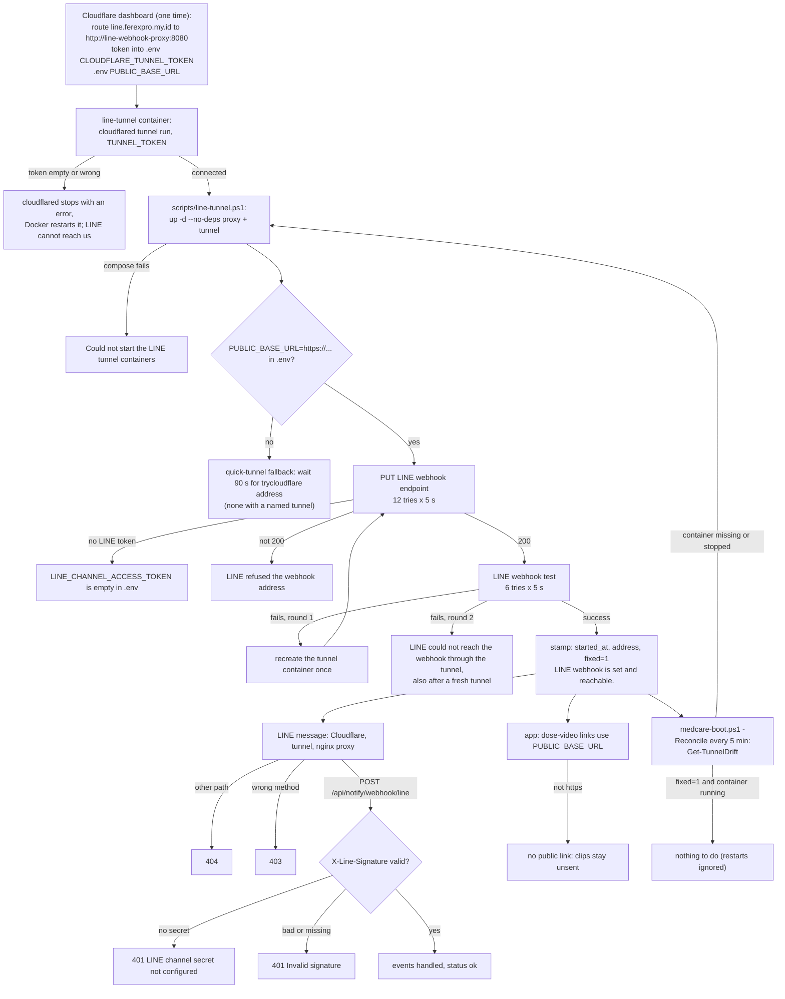

# The stable LINE tunnel

Built 8 Nov 2026 in commit `cf8cf0b` ("LINE tunnel: a named Cloudflare tunnel on a fixed address, cloudflared 2026.10.7"). It builds on three commits from 19 Oct 2026: `3446469` (the address comes from the current start, one fresh start for a dead tunnel, reconcile follows restarts), `051dddb` (the proxy finds the app through Docker's DNS) and `fe16ead` (the script starts only the tunnel and its proxy). Line numbers below are for branch `version-4-competition` at `e96ecf6`. None of these files changed after `cf8cf0b`.

## What it does

LINE has to reach our home server from the internet. It does this to deliver messages (the "webhook") and to let family download dose videos. The server has no public address, so a Cloudflare tunnel carries the traffic. A tunnel is a program (`cloudflared`) inside Docker that keeps an outgoing connection open to Cloudflare. Before 8 Nov we used a "quick tunnel", which got a new random `*.trycloudflare.com` address on every restart, so LINE's webhook had to be updated every time. Now a **named tunnel** on our own domain has one fixed address, `https://line.ferexpro.my.id`, so a restart does not break LINE any more. Only two kinds of request can pass through it: LINE's webhook and the dose-video links. Everything else in the app stays private.

## The flow

1. **One-time setup in Cloudflare (by hand, in the dashboard).** You create a named tunnel. You add a route (Cloudflare calls it a "public hostname") that sends `line.ferexpro.my.id` to `http://line-webhook-proxy:8080`. You copy the tunnel's token into `.env` as `CLOUDFLARE_TUNNEL_TOKEN`. You set `PUBLIC_BASE_URL=https://line.ferexpro.my.id` in `.env`.
2. **The tunnel container starts** (`docker compose --profile line up -d`). `cloudflared tunnel run` reads the token from the `TUNNEL_TOKEN` variable and connects to Cloudflare. Cloudflare sends it the route, and it logs `Updated to new configuration` and four `Registered tunnel connection` lines.
   - *Refusal:* if `CLOUDFLARE_TUNNEL_TOKEN` is empty or wrong, cloudflared stops with an error. Because of `restart: unless-stopped`, Docker keeps restarting it. LINE then cannot reach the server.
3. **You run `scripts/line-tunnel.ps1`** (or `scripts/medcare-boot.ps1` runs it for you at logon). It starts only the proxy and the tunnel (`--no-deps`, so the app and the database are never recreated from here).
   - *Failure:* `Could not start the LINE tunnel containers`.
4. **The script reads the fixed address.** It looks for `PUBLIC_BASE_URL=https://...` in `.env`. Then, at the start of each round (see step 6), it checks that the tunnel container exists and prints `Tunnel: https://line.ferexpro.my.id`.
   - *Failure:* `The line-tunnel container is not there (docker compose --profile line ps)`.
   - *Fallback:* if `PUBLIC_BASE_URL` is empty, it waits up to 90 s for a quick tunnel's `trycloudflare.com` address in the tunnel log. If none appears: `The tunnel did not report an address within 90 s (docker compose --profile line logs line-tunnel)`. With the named tunnel this fallback never finds an address, so `PUBLIC_BASE_URL` must be set.
5. **The script tells LINE the webhook address.** A small Python program runs inside the app container. It sends `PUT .../webhook/endpoint` with `https://line.ferexpro.my.id/api/notify/webhook/line`, up to 12 times, 5 s apart. It prints `set webhook: <status> <body> <endpoint>`.
   - *Refusal:* `LINE_CHANNEL_ACCESS_TOKEN is empty in .env`.
   - *Refusal:* `LINE refused the webhook address`.
6. **The script asks LINE to test the webhook.** LINE sends a real, signed test request through Cloudflare, the tunnel, the proxy and the app. The script tries up to 6 times and prints `LINE test: <status> <body>`. Then it asks LINE where it now sends, and prints `LINE now sends to: <endpoint> | active: <True/False>`.
   - *Failure, first round:* `LINE could not reach the webhook through the tunnel: recreating the tunnel container once`. The tunnel container is recreated (a fresh connection to Cloudflare) and steps 5-6 run again.
   - *Failure, second round:* `LINE could not reach the webhook through the tunnel, also after a fresh tunnel`. Note: a wrong `LINE_CHANNEL_SECRET` also ends here, because the app answers LINE's test with 401 (step 8). Read the `LINE test:` line: its body shows the status code LINE got.
7. **Success.** The script writes `logs\line-tunnel.stamp` with three lines: `started_at=...`, `address=https://line.ferexpro.my.id` and `fixed=1`. It prints `LINE webhook is set and reachable.`
8. **A real LINE message arrives.** LINE sends it to Cloudflare, Cloudflare sends it down the tunnel to the nginx proxy, and the proxy forwards it to the app.
   - *Proxy refusals:* any other path gets `404`. A non-POST request to the webhook path, or a non-GET/HEAD request to a video link, gets `403`. A body over 256 KB gets `413`. (The app's second webhook path, `/line/webhook`, is therefore not reachable from the internet.)
   - *App refusals:* the app checks the `X-Line-Signature` header (an HMAC-SHA256 of the body made with the channel secret, so only LINE can make it). No secret configured gives `401 {"error": "LINE channel secret not configured"}`. A missing or wrong signature gives `401 {"error": "Invalid signature"}`. Both happen before the body is parsed or the database is touched.
   - *Success:* the app logs `[LINE] webhook event: <type>`, handles the event and answers `{"status": "ok"}`.
9. **The app builds dose-video links.** For a dose video, the family's LINE app downloads the clip from `https://line.ferexpro.my.id/api/media/line/<43-character token>.mp4` (and `.jpg` for the preview). Because `PUBLIC_BASE_URL` is set and starts with `https://`, the app uses it directly.
   - *Refusal:* if `PUBLIC_BASE_URL` is set but not `https://`, there is no public link. The log says `dose videos: no public link (PUBLIC_BASE_URL is not https); ...` and clips stay unsent.
   - *Only when `PUBLIC_BASE_URL` is empty:* the app asks LINE for the webhook address and probes it with a secret test link (reasons: `no LINE token`, `LINE webhook endpoint error`, `tunnel not answering`, `tunnel reaches another server`).
10. **The app's startup report.** Shortly after start (after the network probes, `app/startup_report.py:272-279`), the app logs `[STARTUP] line: OK channel token set; public link https://line.ferexpro.my.id`. If there is no public link it logs `[STARTUP] line: DEGRADED: ...; no public link: <reason>: family get no videos`.
    - *Important:* with `PUBLIC_BASE_URL` set, this check does **not** contact the tunnel. "OK" here means "the address is configured", not "the tunnel is up". The real end-to-end check is LINE's test in step 6.
11. **The boot script keeps watch.** `scripts/medcare-boot.ps1 -Reconcile` runs every 5 minutes. `Get-TunnelDrift` compares the tunnel container with the stamp. With `fixed=1` in the stamp, a tunnel restart is **ignored** (the address did not change). It reruns `line-tunnel.ps1` only when the container is missing (`the tunnel container is not there`), not running (`the tunnel container is exited`, for example), or the stamp has no address (`no address in logs\line-tunnel.stamp`). At logon (no `-Reconcile`), it always reruns `line-tunnel.ps1`, so every boot re-registers the webhook and runs LINE's test.

## Diagram



## The code that runs it

### Step 1-2: the tunnel and proxy containers

`docker-compose.yml:56-82`

```yaml
  # LINE webhook, the app's only public entry point. Opt-in: scripts/line-tunnel.ps1
  # The tunnel reaches only this proxy, and the proxy forwards only POST /api/notify/webhook/line
  # (signed by LINE; the app verifies X-Line-Signature) and GET of dose-video links
  # (/api/media/line/<43-character token>.mp4|.jpg). The rest of the app stays on the LAN.
  line-webhook-proxy:
    image: nginx:1.27-alpine
    profiles: ["line"]
    volumes:
      - ./scripts/line-webhook/nginx.conf:/etc/nginx/conf.d/default.conf:ro
    depends_on:
      - app
    restart: unless-stopped

  # Cloudflare quick tunnel: free, no account, but a new https://*.trycloudflare.com address on every
  # start. scripts/line-tunnel.ps1 reads it and updates the LINE webhook setting.
  line-tunnel:
    image: cloudflare/cloudflared:2026.10.7
    profiles: ["line"]
    # Named Cloudflare tunnel (8 Nov 2026): a fixed address on our own domain, so a restart no longer changes it.
    # Its route (Cloudflare dashboard) sends the hostname in PUBLIC_BASE_URL to http://line-webhook-proxy:8080.
    # The token stays in .env (CLOUDFLARE_TUNNEL_TOKEN); empty means cloudflared stops with an error.
    command: ["tunnel", "--no-autoupdate", "run"]
    environment:
      TUNNEL_TOKEN: ${CLOUDFLARE_TUNNEL_TOKEN:-}
    depends_on:
      - line-webhook-proxy
    restart: unless-stopped
```

Both containers belong to the `line` profile, so they start only when asked (`--profile line`). `tunnel run` with `TUNNEL_TOKEN` is how a named tunnel starts: the token says which tunnel this is, and the route comes from Cloudflare, not from this file. The old comment at lines 69-70 still describes the quick tunnel; the comment at lines 74-76 is the current one.

The route itself lives only in the Cloudflare dashboard. You can see what Cloudflare sent in the tunnel log: `Updated to new configuration config="{"ingress":[{"hostname":"line.ferexpro.my.id", "service":"http://line-webhook-proxy:8080"}, {"service":"http_status:404"}] ...`. Any other hostname gets Cloudflare's own 404.

`.env.example:63-67`

```
# The LINE webhook tunnel (docker compose --profile line): a named Cloudflare tunnel. Its token, from the Cloudflare
# dashboard (Networks > Tunnels > the tunnel > the Docker command's --token value). Secret: never print or commit it.
CLOUDFLARE_TUNNEL_TOKEN=
# The tunnel's fixed address (https://<hostname>), used for LINE's webhook and the dose-video links.
PUBLIC_BASE_URL=
```

This is where the two settings are explained for a new machine. The real values are only in `.env`, which is not committed.

### Step 3: start only the tunnel and its proxy

`scripts/line-tunnel.ps1:38-43`

```powershell
Push-Location -LiteralPath $repoRoot
try {
    # --no-deps: a changed postgres or app definition must never recreate them from here (reconcile runs this
    # whatever a dose session is doing); scripts\rebuild-app.ps1 is the guarded way to apply it.
    docker compose --profile line up -d --no-deps line-webhook-proxy line-tunnel | Out-Null
    if ($LASTEXITCODE -ne 0) { throw 'Could not start the LINE tunnel containers' }
```

The script starts (or keeps) the proxy and the tunnel, and never the app or the database. This matters because the boot script may run it during a dose session.

### Step 4: read the fixed address

`scripts/line-tunnel.ps1:85-101`

```powershell
    # The named tunnel's fixed address (PUBLIC_BASE_URL in .env), or '' for a quick tunnel.
    $fixedUrl = ''
    $envLine = Select-String -LiteralPath (Join-Path $repoRoot '.env') -Pattern '^PUBLIC_BASE_URL=(https://\S+)' |
        Select-Object -First 1
    if ($envLine) { $fixedUrl = $envLine.Matches[0].Groups[1].Value.TrimEnd('/') }
    # A tunnel that is up but dead (LINE's test fails) gets one fresh start: a new container (a quick tunnel: a new
    # address; the named tunnel: a fresh connection to Cloudflare).
    for ($round = 1; $round -le 2; $round++) {
        $started = Get-TunnelStartedAt
        if (-not $started) { throw 'The line-tunnel container is not there (docker compose --profile line ps)' }
        if ($fixedUrl) {
            $url = $fixedUrl
        } else {
            $url = Wait-TunnelUrl $started
            if (-not $url) { throw 'The tunnel did not report an address within 90 s (docker compose --profile line logs line-tunnel)' }
        }
        Write-Host "Tunnel: $url"
```

The script reads `PUBLIC_BASE_URL` straight from `.env` (only an `https://` value counts). With a fixed address it skips the log search that the quick tunnel needed. The loop runs at most twice (see step 6).

### Step 5: tell LINE the webhook address

`scripts/line-tunnel.ps1:61-72` (inside the Python program the script sends to the app container)

```python
if not config.LINE_CHANNEL_ACCESS_TOKEN:
    sys.exit("LINE_CHANNEL_ACCESS_TOKEN is empty in .env")
# A new trycloudflare name can take a while to resolve, and LINE rejects an endpoint it can't resolve yet
# ("Invalid webhook endpoint URL"), so both calls are retried.
for attempt in range(12):
    status, body = call("PUT", "endpoint", {"endpoint": endpoint})
    if status == 200:
        break
    time.sleep(5)
print("set webhook:", status, body or "ok", endpoint)
if status != 200:
    sys.exit("LINE refused the webhook address")
```

The program runs inside the app container so it can use the app's own LINE token from `app.config` without printing it. `endpoint` is the fixed address plus `/api/notify/webhook/line` (line 49).

### Step 6: LINE's test, and one retry with a fresh tunnel

`scripts/line-tunnel.ps1:73-83`

```python
for attempt in range(6):
    status, body = call("POST", "test", {"endpoint": endpoint})
    if body.get("success"):
        break
    time.sleep(5)
print("LINE test:", status, body)
req = urllib.request.Request("https://api.line.me/v2/bot/channel/webhook/endpoint", headers=headers)
with urllib.request.urlopen(req, timeout=20) as resp:
    current = json.loads(resp.read())
print("LINE now sends to:", current.get("endpoint"), "| active:", current.get("active"))
sys.exit(0 if body.get("success") and current.get("endpoint") == endpoint else 1)
```

LINE's test sends a real signed request along the whole path, so success proves Cloudflare, the tunnel, the proxy, the app and the signature check all work. The program also reads back the address LINE now uses and fails if it is not ours.

`scripts/line-tunnel.ps1:102-118`

```powershell
        $python | docker compose exec -T -e "WEBHOOK_URL=$url" -w /app app python -
        if ($LASTEXITCODE -eq 0) {
            New-Item -ItemType Directory -Force -Path (Split-Path $stampFile -Parent) | Out-Null
            # fixed=1: medcare-boot.ps1 -Reconcile then ignores tunnel restarts (the address does not change).
            $stamp = @("started_at=$started", "address=$url")
            if ($fixedUrl) { $stamp += 'fixed=1' }
            Set-Content -LiteralPath $stampFile -Value $stamp -Encoding ASCII
            Write-Host 'LINE webhook is set and reachable.'
            return
        }
        if ($round -eq 1) {
            Write-Host 'LINE could not reach the webhook through the tunnel: recreating the tunnel container once'
            docker compose --profile line up -d --no-deps --force-recreate line-tunnel | Out-Null
            if ($LASTEXITCODE -ne 0) { throw 'Could not recreate the LINE tunnel container' }
        }
    }
    throw 'LINE could not reach the webhook through the tunnel, also after a fresh tunnel'
```

### Step 7: the stamp

The same excerpt (lines 104-109) writes `logs\line-tunnel.stamp`. `fixed=1` is added only when the address came from `PUBLIC_BASE_URL`. The boot script reads this marker in step 11.

### Step 8a: the proxy lets only two paths through

`scripts/line-webhook/nginx.conf:1-17`

```nginx
# All the public tunnel can reach: LINE's webhook, and dose-video links for family. The rest of the app stays private.
server {
    listen 8080;
    server_tokens off;
    client_max_body_size 256k;
    # Docker's DNS, asked again every 10 s: a proxy_pass with a variable resolves at request time, so a recreated app
    # container (a new IP) is found without restarting this proxy. A literal http://app:8000 is resolved once, at start.
    resolver 127.0.0.11 valid=10s ipv6=off;

    location = /api/notify/webhook/line {
        limit_except POST { deny all; }
        set $app_upstream http://app:8000;
        proxy_pass $app_upstream;
        proxy_set_header Host $host;
        proxy_set_header X-Forwarded-For $proxy_add_x_forwarded_for;
        proxy_read_timeout 30s;
    }
```

`scripts/line-webhook/nginx.conf:21-32`

```nginx
    location ~ "^/api/media/line/[A-Za-z0-9_-]{43}\.(mp4|jpg)$" {
        limit_except GET { deny all; }
        set $app_upstream http://app:8000;
        proxy_pass $app_upstream;
        proxy_set_header Host $host;
        proxy_set_header X-Forwarded-For $proxy_add_x_forwarded_for;
        proxy_read_timeout 30s;
    }

    location / {
        return 404;
    }
```

Only the exact webhook path (POST only) and the video-link shape (GET or HEAD only) reach the app. Everything else gets 404 from nginx. Because the app's address is looked up at request time, recreating the app does not need a proxy restart.

### Step 8b: the app checks LINE's signature

`app/routers/api_notify.py:76-102`

```python
@router.post("/webhook/line")
async def line_webhook(request: Request):
    """
    Handle incoming messages from LINE bot.
    Caregivers send verification codes here to link their LINE user_id.
    """
    received_at = datetime.datetime.now(datetime.timezone.utc)   # when we got it, never LINE's event timestamp
    raw_body = await request.body()

    # Verify X-Line-Signature before processing any events
    if not LINE_CHANNEL_SECRET:
        return JSONResponse({"error": "LINE channel secret not configured"}, status_code=401)
    signature = request.headers.get("X-Line-Signature", "")
    expected = base64.b64encode(
        hmac.new(LINE_CHANNEL_SECRET.encode(), raw_body, hashlib.sha256).digest()
    )
    if not hmac.compare_digest(expected, signature.encode("utf-8")):
        return JSONResponse({"error": "Invalid signature"}, status_code=401)

    body = json.loads(raw_body)
    events = body.get("events", [])

    pool = get_pool()
    line_svc = LineService.get_instance()

    for event in events:
        log.info("[LINE] webhook event: %s", event.get("type"))   # the type only: never an ID or a text
```

The tunnel is public, so anyone could send a request to this path. The signature check makes sure only LINE (which knows the channel secret) is believed. `compare_digest` compares in constant time, so the check does not leak the right answer by timing.

### Step 9: the dose-video link uses the fixed address

`app/services/dose_video.py:385-399`

```python
async def public_base_url() -> str | None:
    global _base_url
    if config.PUBLIC_BASE_URL:
        base = config.PUBLIC_BASE_URL if config.PUBLIC_BASE_URL.startswith("https://") else None
        _note(base, None if base else NOT_HTTPS)
        return base
    now = time.monotonic()
    if _base_url is not None:
        checked, base = _base_url
        if now - checked < (BASE_URL_CACHE_SECONDS if base else BASE_URL_RETRY_SECONDS):
            return base
    base, reason = await asyncio.get_running_loop().run_in_executor(None, _webhook_base_url)
    _base_url = (now, base)
    _note(base, reason)
    return base
```

With `PUBLIC_BASE_URL` set, the function returns it at once (lines 387-390) and never probes the tunnel. Lines 391-399 are the older path for an empty `PUBLIC_BASE_URL`: ask LINE for the webhook address and probe it (`_webhook_base_url`, lines 330-358).

`app/services/dose_video.py:361-382`

```python
def _note(base: str | None, reason: str | None) -> None:
    """One log line when the link's state or reason changes, never on every check."""
    global _link_reason, _link_checked
    if reason is not None and (reason != _link_reason or not _link_checked):
        log.warning("dose videos: no public link (%s); clips of doses waiting for family stay unsent until one "
                    "answers", reason)
    elif reason is None and _link_reason is not None:
        log.info("dose videos: the public link %s answers again", base)
    _link_reason, _link_checked = reason, True


def no_link_reason() -> str | None:
    """Why the last check found no public link; None when it found one. Read it through public_link, with the
    answer it explains: a later check (another clip, the job) may change it."""
    return _link_reason


async def public_link() -> tuple[str | None, str | None]:
    """(the public base URL, None), or (None, why there is none): the reason that went with this very answer, read
    before anything else can run, for the WARNING of a clip held back or lost."""
    base = await public_base_url()
    return base, (None if base is not None else no_link_reason())
```

`public_link` returns the address and, if there is none, the reason. `_note` writes a log line only when the state changes, so the log is not flooded.

### Step 10: the startup report

`app/startup_report.py:184-201`

```python
async def public_link() -> None:
    from app.services import dose_video
    try:
        base, why = await dose_video.public_link()
    except Exception as error:
        base = None
        reason = f"{type(error).__name__}"
    else:
        # The tunnel hint only where the tunnel is the cause (no LINE token or a webhook error is not)
        hint = (" (scripts/line-tunnel.ps1 points LINE's webhook at this server)"
                if why in (dose_video.OTHER_SERVER, dose_video.TUNNEL_DOWN) else "")
        reason = f"{why}{hint}: family get no videos"
    stage = _report.get("line", {})
    detail = stage.get("detail", "").split(";")[0]   # the token line, without an earlier public-link verdict
    if base:
        mark("line", stage.get("ok", True), f"{detail}; public link {base}")
    else:
        mark("line", False, f"{detail}; no public link: {reason}", warn=True)
```

This adds the public-link result to the `line` stage of the `[STARTUP]` report (also shown by `GET /health`). `mark` (lines 58-68) writes `[STARTUP] line: OK ...` or `[STARTUP] line: DEGRADED: ...`.

### Step 11: the boot script ignores restarts of a fixed tunnel

`scripts/medcare-boot.ps1:195-211`

```powershell
function Get-TunnelDrift([string]$Facts, [string[]]$StampLines) {
    # Why the LINE webhook may point at a dead address, or '' when it is current. $Facts is the tunnel container's
    # "<State.Status>|<State.StartedAt>"; the stamp is what line-tunnel.ps1 wrote after its last success. The quick
    # tunnel gets a new address whenever its container starts, so the webhook holds only for the stamped start.
    $parts = "$Facts".Trim() -split '\|'
    if ($parts.Count -lt 2 -or -not $parts[1]) { return 'the tunnel container is not there' }
    if ($parts[0] -ne 'running') { return "the tunnel container is $($parts[0])" }
    if ($StampLines -contains 'fixed=1') {
        # The named tunnel (since 8 Nov 2026): its address is fixed, so a restart leaves the webhook valid.
        if (-not @($StampLines | Where-Object { $_ -like 'address=*' })) { return 'no address in logs\line-tunnel.stamp' }
        return ''
    }
    $stamped =@($StampLines | Where-Object { $_ -like 'started_at=*' } | ForEach-Object { $_.Substring(11).Trim() }) | Select-Object -First 1
    if (-not $stamped) { return 'no stamp from line-tunnel.ps1 (logs\line-tunnel.stamp): the webhook was not registered for this tunnel start' }
    if ($stamped -ne $parts[1]) { return "the tunnel restarted at $($parts[1]) (the webhook was registered for its start at $stamped)" }
    return ''
}
```

An empty string means "no drift, do nothing". With `fixed=1`, only a missing or stopped container, or a stamp without an address, counts as drift. The old start-time comparison (lines 207-209) is now used only for a quick tunnel.

`scripts/medcare-boot.ps1:399-407`

```powershell
        $tunnelFacts = (& docker inspect -f '{{.State.Status}}|{{.State.StartedAt}}' $script:TunnelContainer 2>$null | Out-String).Trim()
        $stampFile = Join-Path $script:LogDir 'line-tunnel.stamp'
        $stampLines = if (Test-Path -LiteralPath $stampFile) { @(Get-Content -LiteralPath $stampFile) } else { @() }
        $drift = Get-TunnelDrift $tunnelFacts $stampLines
        if ($Reconcile -and -not $drift) {
            Set-Stage 'line' $true "tunnel running since $(($tunnelFacts -split '\|')[1]), the webhook registered for that start"
        } else {
            if ($Reconcile) { Write-Line 'line' "$drift" }
            Write-Line 'line' "starting the tunnel and registering the webhook (scripts\line-tunnel.ps1; up to a few minutes)"
```

In reconcile mode with no drift, it just records OK. Otherwise (and always at logon) it runs `line-tunnel.ps1`. Note: the OK text "the webhook registered for that start" is older wording; with `fixed=1` the webhook is valid for any start.

## Settings

| Setting | Default | Where it is read | What it changes |
|---|---|---|---|
| `CLOUDFLARE_TUNNEL_TOKEN` (in `.env`, secret) | empty | `docker-compose.yml:79` (passed to cloudflared as `TUNNEL_TOKEN`) | Which named tunnel cloudflared joins. Empty or wrong: cloudflared stops with an error. Never print its value. |
| `PUBLIC_BASE_URL` (in `.env`) | empty | `scripts/line-tunnel.ps1:87` (only an `https://` value), `app/config.py:112` | The fixed address for LINE's webhook and dose-video links. Empty: quick-tunnel fallback in the script, and the probe path in the app. Not `https://`: no dose-video links. Here: `https://line.ferexpro.my.id`. |
| Route in the Cloudflare dashboard | none | Cloudflare, sent to cloudflared at start (log line `Updated to new configuration`) | Hostname `line.ferexpro.my.id` to service `http://line-webhook-proxy:8080`. Must match `PUBLIC_BASE_URL`. |
| `LINE_CHANNEL_ACCESS_TOKEN` (secret) | empty | `app/config.py:89`, used by `scripts/line-tunnel.ps1:50,61`, `scripts/medcare-boot.ps1:391` | Needed to set and test the webhook. Empty: the script stops, and the boot script skips the `line` stage. |
| `LINE_CHANNEL_SECRET` (secret) | empty | `app/config.py:90`, used at `app/routers/api_notify.py:86-92` | Checks LINE's signature. Wrong or empty: every webhook call (and LINE's test) gets 401. |
| `TUNNEL_PROVIDER` | empty | `app/config.py:127`; required by `app/startup_checks.py:20` | The provider name shown in the privacy text (should be "Cloudflare"). |
| cloudflared image | `cloudflare/cloudflared:2026.10.7` | `docker-compose.yml:72` | The tunnel program version. |
| nginx limits | `client_max_body_size 256k`, `proxy_read_timeout 30s`, `resolver ... valid=10s` | `scripts/line-webhook/nginx.conf:5,8,16,27` | Largest webhook body, how long the proxy waits for the app, how often it looks up the app's address. |
| Script retries | PUT 12 x 5 s, test 6 x 5 s, 2 rounds, quick-tunnel wait 90 s | `scripts/line-tunnel.ps1:65,73,92,28` | How long the script tries before it gives up. |
| `BASE_URL_CACHE_SECONDS` / `BASE_URL_RETRY_SECONDS` | 300 / 60 | `app/services/dose_video.py:59-60` | How long the app trusts a probed link. Only used when `PUBLIC_BASE_URL` is empty. |
| `-NoLine` switch | off | `scripts/medcare-boot.ps1:20,392` | Skips the whole `line` stage of the boot script. |
| `-ComposeProject` | `medcareai2` | `scripts/medcare-boot.ps1:22,37` | Container name the boot script checks: `medcareai2-line-tunnel-1`. |

## Logs to read

Tunnel connection (cloudflared's own lines; four `Registered` lines is healthy):

```powershell
docker logs medcareai2-line-tunnel-1 --since 1h 2>&1 | Select-String "Registered tunnel connection|Updated to new configuration|ERR"
```

The app's startup verdict, LINE events and dose-video link problems:

```powershell
docker logs medcareai2-app-1 2>&1 | Select-String "\[STARTUP\] line|\[LINE\] webhook event|dose videos: "
```

Lines you can see there:

- `[STARTUP] line: OK channel token set; public link https://line.ferexpro.my.id`
- `[STARTUP] line: DEGRADED: ...; no public link: <reason>: family get no videos`
- `[LINE] webhook event: message` (the event type only, never an ID or text)
- `dose videos: no public link (<reason>); clips of doses waiting for family stay unsent until one answers`
- `dose videos: the public link <address> answers again`

The proxy (every request, with status code; 404 and 403 are the proxy's refusals):

```powershell
docker logs medcareai2-line-webhook-proxy-1 --since 1h 2>&1 | Select-String "webhook/line|/api/media/line/| 40[34] "
```

The boot script (lines look like `2026-11-09 08:00:00 [STARTUP] line: OK tunnel up, webhook registered`; in reconcile mode they are written only when something changed or failed):

```powershell
Get-Content .\logs\startup-$(Get-Date -Format yyyyMMdd).log | Select-String "\] line: "
```

The stamp (no secrets in it):

```powershell
Get-Content .\logs\line-tunnel.stamp
```

## How to test it

**Automated tests** (run as in `README.md:78`, in a throwaway app container):

- `tests/test_webhook_signature.py`
  - `test_webhook_rejects_unsigned_before_parsing_or_db`: no secret, no signature, or a wrong signature give 401 on both webhook paths, before the database is touched.
  - `test_valid_signature_processes_verification_code`: a correctly signed request is processed.
- `tests/test_dose_video_link.py`
  - `test_public_base_url_is_still_taken_as_configured`: an `https://` `PUBLIC_BASE_URL` is used with no network call; an `http://` one gives `PUBLIC_BASE_URL is not https`.
  - `test_the_startup_report_names_the_reason`, `test_the_startup_report_gives_no_tunnel_hint_without_a_line_token`: the `[STARTUP] line` wording.
  - `test_the_probe_token_has_the_shape_of_a_real_link_token_so_the_line_proxy_forwards_it`: the probe matches the nginx video-link pattern.
- There is no automated test for `Get-TunnelDrift`, `line-tunnel.ps1` or `nginx.conf`. Use the manual check below.

**Manual check** (PowerShell, in the repo folder):

1. Run the script. You should see `Tunnel: https://line.ferexpro.my.id`, `set webhook: 200 ...`, `LINE test: 200 {'success': True, ...}` and `LINE webhook is set and reachable.`
   ```powershell
   & .\scripts\line-tunnel.ps1
   ```
2. Check the proxy blocks other paths. Both should fail with 404 (other path) and 403 (GET on the webhook):
   ```powershell
   try { Invoke-WebRequest https://line.ferexpro.my.id/ -UseBasicParsing } catch { $_.Exception.Response.StatusCode.value__ }
   try { Invoke-WebRequest https://line.ferexpro.my.id/api/notify/webhook/line -UseBasicParsing } catch { $_.Exception.Response.StatusCode.value__ }
   ```
3. Check an unsigned POST is refused by the app with 401 `Invalid signature`:
   ```powershell
   try { Invoke-WebRequest https://line.ferexpro.my.id/api/notify/webhook/line -Method Post -Body '{}' -ContentType 'application/json' -UseBasicParsing } catch { $_.Exception.Response.StatusCode.value__ }
   ```
4. Restart the tunnel and confirm nothing else is needed: `docker restart medcareai2-line-tunnel-1`, wait for four `Registered tunnel connection` lines, then send a message to the LINE bot and look for `[LINE] webhook event: message` in the app log. The next reconcile run should not rerun `line-tunnel.ps1`.

## Rotate the tunnel token

Do this if the token may have leaked, or as routine hygiene. The address does not change, so LINE needs no update.

1. In the Cloudflare dashboard, open Networks > Tunnels > this tunnel and refresh (rotate) its token. Copy the new `--token` value from the Docker install command. (The exact button name in Cloudflare's dashboard can change; check Cloudflare's docs if you cannot find it.) Rotating disconnects the old token.
2. Open `.env` in an editor and replace the value after `CLOUDFLARE_TUNNEL_TOKEN=`. Do not paste the token into chat, logs or a commit.
3. Recreate only the tunnel: `docker compose --profile line up -d --no-deps --force-recreate line-tunnel`
4. Check the log for four `Registered tunnel connection` lines (command above). Optional: run `.\scripts\line-tunnel.ps1` to get LINE's test result.

## If the route hostname changes

If you move to a different hostname (for example a new domain), all three places must agree:

1. **Cloudflare dashboard:** edit the tunnel's route so the new hostname goes to `http://line-webhook-proxy:8080` (plain `http`, the container name, port 8080). Cloudflare creates the DNS record for a domain it manages.
2. **`.env`:** set `PUBLIC_BASE_URL=https://<new hostname>`.
3. **The app:** it reads `PUBLIC_BASE_URL` only at start, so recreate it with `.\scripts\rebuild-app.ps1` (it waits until no dose session is running). Until then, new dose-video links still use the old address.
4. **LINE:** run `.\scripts\line-tunnel.ps1`. It sets LINE's webhook to the new address, runs LINE's test and writes a new stamp. The reconcile run does not do this for you, because with `fixed=1` it only watches whether the container runs.
5. Check: the tunnel log's `Updated to new configuration` line shows the new hostname, and the app log shows `[STARTUP] line: OK channel token set; public link https://<new hostname>`.

Dose-video links that were already sent with the old address stop working once the old hostname is removed from the route.
